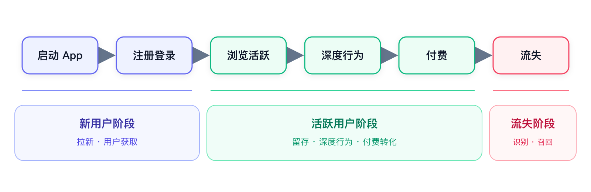

# Recommendation & Search Design Lab

个人设计的推荐与搜索方案、原型图和独立实验。

## 内容

- `docs/`：浏览历史推荐、标签与社区推荐、离线与在线搜索全链路设计。
- `figures/`：用户流程、双塔召回、搜索链路的可编辑 Draw.io / SVG 与已有 PNG。
- `notebooks/`：三份 TenRec 多路召回实验，保留原有输出。
- `src/`：文本 embedding、Leiden 社区划分、模拟用户生成实验。
- `benchmarks/`：Qwen / DeepSeek 查询改写测试；凭据从环境变量读取。
- `results/`：已有查询改写聚合测试结果。

## 使用

安装 `requirements.txt` 后，根据各脚本 `--help` 和 Notebook 中的说明准备输入文件。TenRec 实验使用公开数据集，仓库不包含公司的帖子、用户、标签导出或 embedding 缓存。方案中有些表结构与链路是设计建议，并非可直接启动的完整服务。

运行 API 基准需要自行设置 `DASHSCOPE_API_KEY` 或 `DEEPSEEK_API_KEY`；`.env.example` 只有空值。当前公开副本未重新调用 API 或训练模型。

公开范围为个人设计文档与独立实验；未包含 Nalook master、Codeup 后端、生产数据库连接配置、Cookie 或环境目录。文档和第三方模型/数据保留各自来源，本仓库没有为第三方材料另行授予许可证。
