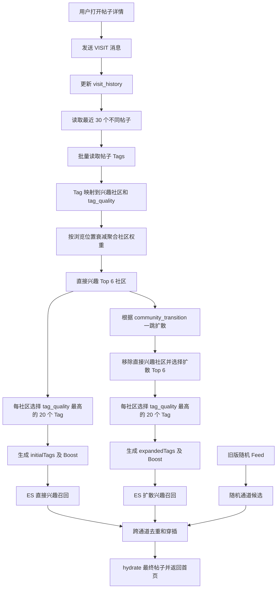

# Nalook 基于浏览历史的首页个性化推荐方案

> 文档版本：v1.0  
> 对应代码基线：`nalook-master-version3`  
> 整理日期：2026-08-20  
> 适用范围：首页信息流的个性化推荐，不包含关键词搜索和帖子详情页关联推荐  
> 文档结构：第一部分记录 version3 原始实现；第二部分记录上线观察到的问题、讨论过程和本次优化。

---

# 第一部分：version3 原始推荐方案

## 1. 目标与总体思路

version3 的目标是利用登录用户最近浏览过的帖子构建短期兴趣画像，并将首页信息流拆成三条通道：

1. **直接兴趣通道（INIT）**：推荐与用户近期浏览主题直接相关的帖子；
2. **扩散兴趣通道（EXP）**：沿社区转移关系探索相邻兴趣，降低推荐过窄的风险；
3. **随机通道（RAND）**：保留大盘随机和新鲜内容，承担冷启动、探索和兜底。

原始完整链路如下：



## 2. 离线数据准备

在线推荐依赖两类版本化离线数据：

- `community_tag_map`：Tag 属于哪个兴趣社区，以及 Tag 的质量；
- `community_transition`：社区之间的一跳转移概率。

两张表必须使用相同的 `dataset_version`。线上通过 `COMMUNITY_DATASET_VERSION` 指向当前生效版本，避免离线数据更新过程中读到不一致的数据。

### 2.1 Tag 社区划分

离线流程先对 Tag 生成 Embedding，然后建立 Tag 相似图，并使用 Leiden 算法完成社区发现。

version3 脚本的主要默认参数为：

| 参数 | 默认值 | 含义 |
|---|---:|---|
| `top-k` | 20 | 每个 Tag 寻找的近邻数量 |
| `similarity-threshold` | 0.77 | Tag 相似边最低相似度 |
| `mutual` | true | 只保留互为 Top-K 的边 |
| `resolution` | 16.0 | Leiden 社区粒度 |
| `seed` | 42 | 离线聚类随机种子 |

社区示意：

```text
社区 101：露营、帐篷、天幕、睡袋、露营灯……
社区 102：露营地、杭州露营、亲子露营、自驾露营……
社区 205：客厅设计、原木风、软装、收纳……
社区 310：黑胶、爵士乐、唱片、音响……
```

### 2.2 Tag 质量

每个 Tag 的 `tag_quality` 由帖子覆盖量计算：

```text
tag_quality(t)
= sqrt(log(1 + N / (df(t) + 5)))
  × sqrt(df(t) / (df(t) + 5))
```

其中：

- `N`：有 Tag 的去重帖子总数；
- `df(t)`：包含 Tag `t` 的去重帖子数。

该公式同时处理两个问题：

- 太常见的 Tag 区分度不足，IDF 部分降低其权重；
- 极少出现的 Tag 可信度不足，reliability 部分降低其权重。

### 2.3 社区转移关系

社区转移优先根据帖子中不同社区的共现关系计算。对于源社区 `c` 和目标社区 `d`：

```text
confidence(c→d) = cooccurrence(c,d) / post_count(c)

lift(c,d) = cooccurrence(c,d) × N
            / (post_count(c) × post_count(d))

shrinkage(c,d) = cooccurrence(c,d)
                 / (cooccurrence(c,d) + 5)

raw_weight(c→d)
= confidence(c→d)
  × min(lift(c,d), 5)^0.3
  × shrinkage(c,d)
```

每个源社区最多保留 20 条边，再按行归一化：

```text
transition_probability(c→d)
= raw_weight(c→d) / Σ raw_weight(c→j)
```

主要默认参数：

| 参数 | 默认值 |
|---|---:|
| 最小共现次数 | 3 |
| Lift 指数 `beta` | 0.3 |
| 收缩参数 | 5.0 |
| Lift 上限 | 5.0 |
| 每个源社区最大转移数 | 20 |

只有当一个社区完全没有共现邻居时，才使用社区中心向量作为回退：相似度不低于 0.60、最多 20 个目标社区，使用温度 0.10 的 Softmax 归一化。

## 3. 浏览历史的记录方式

### 3.1 写入时机

用户打开帖子详情时，`PostProcessController.getOne()` 会调用 `visitOne()`，向 RabbitMQ 的 `document.action` 队列发送 `VISIT + POST + postId + userId` 消息。

MQ 消费者最终调用 `CommonProcessController.documentAction()`：

1. 根据 `user_id + document_type + document_id` 查找历史记录；
2. 不存在则新建 `VisitHistory`；
3. 已存在则只把 `datetime` 更新为当前时间；
4. 同时增加帖子的全站 `visit_count`。

### 3.2 历史记录语义

数据库唯一约束为：

```text
(user_id, document_type, document_id)
```

所以 `visit_history` 保存的是“最近访问过的不同帖子”，不是完整的访问事件流：

- 同一帖子重复浏览不会新增多行；
- 重复浏览只会把该帖子移动到最近位置；
- 当前画像无法知道同一帖子被浏览了几次；
- 匿名访问只增加全站浏览量，不产生个人历史画像。

## 4. 在线用户兴趣计算

核心入口为 `PostRecommendProcessController.computePreference(userId)`。

### 4.1 读取范围与冷启动

原始参数：

| 参数 | 原始值 | 作用 |
|---|---:|---|
| 最近浏览帖子数 | 30 | 只读取最近 30 个不同帖子 |
| 最少历史帖子数 | 3 | 少于 3 个时返回空画像 |
| 浏览位置半衰期 | 5 | 最近行为快速占据主导 |
| 直接兴趣社区 Top-K | 6 | 只保留权重最高的 6 个社区 |
| 扩散兴趣社区 Top-K | 6 | 只保留权重最高的 6 个扩散社区 |
| 每社区代表性 Tag 数 | 20 | 按 tag_quality 固定取 Top 20 |

以下情况直接降级为空画像：

- `COMMUNITY_DATASET_VERSION = 0`；
- 最近浏览帖子少于 3 个；
- 历史帖子没有可用 Tag；
- Tag 无法映射到生效版本的社区；
- 画像计算过程中出现异常。

### 4.2 原始浏览位置衰减

最近帖子在前，历史位置从 `i=0` 开始：

```text
decay(i) = 0.5^(i / 5)
```

部分位置的单条权重：

| 浏览位置 | `i` | 原始权重 |
|---:|---:|---:|
| 第 1 条 | 0 | 1.0000 |
| 第 2 条 | 1 | 0.8706 |
| 第 6 条 | 5 | 0.5000 |
| 第 11 条 | 10 | 0.2500 |
| 第 21 条 | 20 | 0.0625 |
| 第 30 条 | 29 | 0.0179 |

### 4.3 直接兴趣社区累计权重

对历史帖子中的每个有效 Tag，查出其社区和 `tag_quality`，原始社区权重为：

```text
W_initial(c)
= Σ[历史帖子 p_i]
  Σ[tag t 属于 p_i 且 community(t)=c]
  decay(i) × tag_quality(t)
```

同一社区命中的多个 Tag 使用求和累计。计算完成后，按 `W_initial` 从高到低保留 Top 6 社区。

### 4.4 扩散兴趣社区累计权重

使用直接兴趣 Top 6 的原始权重做一跳扩散：

```text
W_expanded(d)
= Σ[source c]
  W_initial(c) × transition_probability(c→d)
```

同一个目标社区可以接收多个源社区的贡献，使用求和累计。之后：

1. 删除已经位于直接兴趣 Top 6 的社区；
2. 按 `W_expanded` 选出扩散兴趣 Top 6。

### 4.5 社区展开成代表性 Tags

直接兴趣和扩散兴趣都按照相同方式展开：

1. 查询该社区的所有 Tags；
2. 按 `tag_quality` 降序；
3. 固定选择前 20 个，而不是随机抽样；
4. 计算 Tag 的召回权重：

```text
tagBoost(t) = communityWeight(community(t)) × tag_quality(t)
```

因此，每个社区虽然都提供 20 个召回 Tag，但这些 Tag 并不等权：社区累计权重越高，该社区下所有代表性 Tag 的 Boost 越高。

输出结构：

```kotlin
PreferenceResult(
    initialTags: Map<String, Double>,
    expandedTags: Map<String, Double>
)
```

## 5. ES 个性化召回与排序

直接兴趣和扩散兴趣分别执行一次独立 ES 查询。当前个性化推荐只使用 `tags` 精确匹配，不使用标题/正文 BM25，也不使用帖子向量 kNN。

### 5.1 候选范围

帖子命中任意一个偏好 Tag 即可进入该通道候选集：

```text
post.tags 包含 tag_1 OR tag_2 OR ... OR tag_n
minimum_should_match = 1
```

`request.excludeCodes` 中已经下发的帖子会被排除；最近浏览的 30 个帖子不会被自动排除，除非前端也将其 code 放入 `excludeCodes`。

### 5.2 通道内打分

ES 使用 `function_score`，并设置：

```text
scoreMode = Sum
boostMode = Replace
```

这意味着原始 Query 分数被丢弃，帖子分数只来自三个函数：

```text
score(post)
= Σ[post 命中的偏好 Tag t] tagBoost(t) × 1.0
  + random_score(seed, _seq_no) × 1.0
  + gauss(prepared_datetime, scale=3d, decay=0.5) × 0.3
```

原始配置：

| 参数 | 默认值 |
|---|---:|
| `relevanceWeight` | 1.0 |
| `randomWeight` | 1.0 |
| `gaussWeight` | 0.3 |
| `gaussScale` | 3d |
| `overFetch` | 3 |

因此，命中更多高权重偏好 Tag 的帖子在通道内排名更高；随机分用于同一相关范围内换一批内容；新鲜度分轻度偏向新帖子。

## 6. 三通道编排

### 6.1 原始通道比例

系统热配置默认值：

```text
INIT = 12
EXP  = 12
RAND = 6
```

它们是比例而不是固定数量。默认占比：

```text
直接兴趣 40% + 扩散兴趣 40% + 随机探索 20%
```

使用最大余数法换算为当前页面坑位：

| pageSize | INIT | EXP | RAND |
|---:|---:|---:|---:|
| 30 | 12 | 12 | 6 |
| 20 | 8 | 8 | 4 |

### 6.2 超额召回

每条通道实际取 `quota × overFetch` 个候选。`overFetch=3` 时：

| pageSize=30 | 页面配额 | 候选数量 |
|---|---:|---:|
| INIT | 12 | 36 |
| EXP | 12 | 36 |
| RAND | 6 | 18 |

### 6.3 随机通道

随机通道复用旧版 `feed()`，内部排序为：

```text
random_score × 5.0
+ gauss(prepared_datetime, scale=3h, decay=0.8) × 6.0
```

无关键词时还会按 `prepared_by` 折叠，使随机通道同一作者默认只保留一篇。

### 6.4 去重、穿插与借坑

三条候选队列分别完成通道内排序后：

1. 跨通道去重，同一帖子归属优先级为 `INIT > EXP > RAND`；
2. 根据通道坑位使用 stride 均匀穿插，避免同一通道连续扎堆；
3. 目标通道没有候选时，优先从 `RAND → EXP → INIT` 借坑；
4. 全部通道枯竭时自然结束；
5. 只对最终选中的帖子 ID 做一次 hydrate；
6. 最终不再把三条通道候选放入同一张总榜比较分数。

## 7. 个性化门禁与降级

只有满足以下条件才进入个性化推荐：

- 用户已经登录；
- 当前请求没有 `quickSearch`；
- `RECOMMEND_PERSONALIZED_ENABLED = 1`；
- `COMMUNITY_DATASET_VERSION > 0`；
- 用户至少有 3 个有效浏览帖子；
- 能生成非空直接或扩散偏好；
- APP 版本满足灰度要求。

默认热配置中：

```text
RECOMMEND_PERSONALIZED_ENABLED = 0
COMMUNITY_DATASET_VERSION = 0
RECOMMEND_IOS_MIN_APPCODE = 14
```

所以仅看代码默认值时个性化处于关闭状态，实际线上值以 `system_attribute` 表为准。

任何画像计算、ES 召回或 hydrate 异常都会返回 `null`，上层自动回落旧版随机 Feed，避免首页 500 或空结果。

## 8. 原版方案的关键特性与限制

### 8.1 已具备的能力

- 使用近期浏览建立短期兴趣；
- 使用 Tag 社区减少原始 Tag 的稀疏性；
- 使用社区转移实现一跳探索；
- 直接、扩散、随机三通道具有独立配额；
- 支持随机种子、翻页排除、超额召回和跨通道去重；
- 离线数据版本化，异常可安全降级。

### 8.2 原版暂未覆盖的信号

- 点赞、收藏、评论、分享没有进入兴趣画像；
- 没有停留时长、快速退出等强弱浏览信号；
- 重复浏览只刷新时间，不累计浏览次数；
- 没有负反馈或“不感兴趣”信号；
- 代表性 Tag Top 20 固定，社区长尾 Tag 很难进入召回；
- 个性化通道没有作者折叠或社区硬配额；
- ES Tags 缺少统一 normalizer 时，大小写和重音变体可能漏匹配；
- `PostVisitCache` 虽已定义和注入，但当前访问链路没有实际使用。

---

# 第二部分：问题发现与本次优化记录

## 9. 线上/测试现象

在实际浏览中发现：用户连续浏览某个相关主题的若干帖子后，Nalook 后续推荐的大部分内容都集中在该主题，形成明显的“主题霸屏”。

典型表现：

```text
用户近期连续浏览数篇露营帖子
    ↓
露营相关社区累计权重快速升高
    ↓
直接兴趣通道大量召回露营内容
    ↓
用户首页感知为内容单一、探索不足
```

## 10. 原因分析

### 10.1 原始半衰期过短

原始半衰期为 5：

```text
decay(i) = 0.5^(i / 5)
```

30 条历史的权重占比为：

| 历史范围 | 原始权重占比 |
|---|---:|
| 最近 5 条 | 50.8% |
| 最近 10 条 | 76.2% |
| 第 11～30 条 | 23.8% |
| 第 21～30 条 | 4.8% |

所以最近几次连续浏览足以压过用户之前形成的多主题兴趣。第 20～30 条历史虽然被读取，但实际影响非常弱。

### 10.2 相同数量的代表性 Tag 不等于社区等权

直接兴趣 Top 6 每个社区都固定取 20 个代表性 Tags，这保证了每个社区拥有相同数量的召回入口，但并不代表社区等权。

原因是最终 Tag Boost 仍然包含社区累计权重：

```text
tagBoost = communityWeight × tag_quality
```

例如：

```text
露营社区权重 = 10，提供 20 个 Tags
音乐社区权重 = 2，提供 20 个 Tags
```

即使两个社区 Tag 数量相同，在 Tag 质量相近时，露营社区每个召回条件的分数约为音乐社区的 5 倍。此外，不同社区 Top 20 Tags 在帖子库中的覆盖量也不同。

### 10.3 本轮明确不处理的因素

经过讨论，本轮不处理以下问题：

1. **不做每帖 Tag 数量归一化**：目前约 99% 的帖子都有约 10 个 Tags，Tag 数量差异不被视为主要原因；
2. **不增加社区硬配额**：每个 Top 6 社区已经拥有 20 个召回入口，先通过权重层优化观察效果；
3. **不修改扩散逻辑**：扩散兴趣仍承担探索作用，转移概率、Top 6 和扩散 Tag Boost 均保持原样；
4. **不采用完全等权历史**：完全等权会降低用户兴趣变化后的响应速度，而且同主题帖子仍会按出现次数累计。

## 11. 第一版优化决策

本次只实施两项修改：

1. 浏览位置半衰期从 5 调整为 15；
2. 仅对直接兴趣 Top 6 社区做 `0.7` 次幂软化，并保持 Top 6 总权重不变。

### 11.1 半衰期从 5 调整为 15

新公式：

```text
decay(i) = 0.5^(i / 15)
```

调整前后对比：

| 历史范围 | 半衰期 5 | 半衰期 15 |
|---|---:|---:|
| 最近 5 条 | 50.8% | 27.5% |
| 最近 10 条 | 76.2% | 49.3% |
| 第 11～30 条 | 23.8% | 50.7% |
| 第 21～30 条 | 4.8% | 19.6% |
| 第 30 条单条权重 | 0.0179 | 0.2618 |

效果预期：

- 保留“近期行为更重要”的方向；
- 避免最近几次浏览立即覆盖长期兴趣；
- 让最近 30 条历史中的后 20 条真正参与画像。

### 11.2 直接兴趣社区权重软化

先按新半衰期计算原始社区权重，并选择直接兴趣 Top 6：

```text
W(c) = 原始直接兴趣社区累计权重
```

软化指数：

```text
gamma = 0.7
```

为了只改变社区之间的比例，不改变直接兴趣相关性相对于随机分和新鲜度分的整体量级，采用“保总量软化”：

```text
T = Σ[Top 6] W(c)

W_soft(c)
= T × W(c)^0.7
  / Σ[Top 6] W(j)^0.7
```

该变换具有以下性质：

- `0.7` 次幂是单调变换，Top 6 社区的顺序不变；
- 头部社区和尾部社区的倍数差距缩小；
- Top 6 社区的总权重保持不变；
- 只影响直接兴趣 Tags 的 Boost。

示例：

```text
原始头尾权重：10 : 1
0.7 次幂后比例：约 5.01 : 1
```

## 12. 扩散逻辑的边界

扩散社区本身也有累计权重：

```text
W_expanded(d)
= Σ W_initial(c) × transition_probability(c→d)
```

本次实现中明确保留两份直接兴趣权重：

```text
原始 initialTopK
    ├─ 软化后生成 initialTags，供直接兴趣召回
    └─ 不软化，原样计算 expandedWeights
```

因此：

| 环节 | 半衰期 15 | 社区软化 |
|---|---:|---:|
| 直接兴趣社区 | 生效 | 生效 |
| 直接兴趣 Tags Boost | 生效 | 生效 |
| 扩散兴趣源权重 | 会因半衰期变化 | 使用未软化权重 |
| 社区转移概率 | 不修改 | 不修改 |
| 扩散社区 Top 6 | 保持原逻辑 | 不软化 |
| 扩散 Tags Boost | 保持原逻辑 | 不软化 |

也就是说，半衰期调整会自然传导到扩散画像，但本次社区软化不会直接影响扩散逻辑。

## 13. 代码实现记录

本次只修改一个运行源码文件：

```text
src/main/kotlin/com/yubeitech/nalook/process/controller/feed/
PostRecommendProcessController.kt
```

核心实现：

```kotlin
val initialTopK = initialWeights.topKByWeight(PREF_TOP_K_COMMUNITY)

// 只用于直接兴趣召回
val softenedInitialTopK =
    initialTopK.softenWeights(PREF_COMMUNITY_SOFTENING_EXPONENT)

// 扩散仍使用未软化的 initialTopK
initialTopK.forEach { (source, weight) ->
    transitions[source].orEmpty().forEach { (target, probability) ->
        expandedWeights.merge(target, weight * probability, Double::plus)
    }
}

PreferenceResult(
    initialTags = expandToTagBoosts(softenedInitialTopK, topTagsByCommunity),
    expandedTags = expandToTagBoosts(expandedTopK, topTagsByCommunity)
)
```

新增/调整常量：

```kotlin
private const val PREF_HALF_LIFE = 15.0
private const val PREF_COMMUNITY_SOFTENING_EXPONENT = 0.7
```

补丁文件 `recommendation-half-life-softening.patch` 只用于代码交接，不属于运行时文件，无需提交到项目仓库。

## 14. 验证情况

已完成：

- 补丁正向/反向上下文检查；
- 软化函数公式验证；
- 社区总权重保持不变验证；
- 社区顺序保持不变验证；
- 扩散仍引用原始 `initialTopK` 的代码检查。

示例公式验证结果：

```text
原始总权重 = 21.5
软化后总权重 = 21.5
原始头尾比例 = 10.0
软化后头尾比例 ≈ 5.0119
```

本机 Gradle 已启动，但完整编译被项目私有插件阻断：

```text
com.kodepure.plugin.kodepure-product-plugin:1.0.0
```

当前机器的 MavenLocal 和公共仓库中不存在该公司内部插件，因此需要在具备公司依赖环境的开发机或 CI 流水线中完成最终编译。

## 15. 上线后的观察指标

为了判断这次修改是否真正缓解霸屏，建议按请求记录以下调试字段或离线抽样：

```text
user_id
最近 30 个 post_id
原始 initial Top 6 社区及权重
软化后 initial Top 6 社区及权重
expanded Top 6 社区及权重
每条通道召回数、去重后数量、实际下发数量
最终页面各社区帖子数
```

建议重点观察：

1. Top 1直接兴趣社区的权重占比；
2. Top 1主题在整页中的帖子占比；
3. 页面覆盖的社区数量；
4. INIT/EXP/RAND 实际下发比例；
5. 点击率、收藏率和下一页继续浏览率；
6. 用户连续浏览同主题 3～5 篇后，其他历史兴趣是否仍能进入结果。

## 16. 后续备选优化，不属于本次实现

如果半衰期15和直接兴趣软化后仍然存在主题霸屏，可按以下顺序继续评估：

1. 将半衰期和软化指数移动到热配置，支持小流量调参；
2. 对直接兴趣候选做社区多样性重排，而不是立刻增加多次 ES 查询；
3. 设置直接兴趣通道的单社区软上限或重复惩罚；
4. 将每社区固定 Top 20 Tags 改为“固定核心 Tags + 质量加权探索 Tags”；
5. 引入点赞、收藏、评论等更强行为信号；
6. 增加停留时长、快速退出和负反馈；
7. 区分短期会话兴趣与长期用户兴趣。

这些方向应在本次参数修改完成效果评估之后再决定，避免一次改动过多导致无法归因。

---

## 附录：当前关键参数总览

| 模块 | 参数 | 原版 | 本次修改后 |
|---|---|---:|---:|
| 历史画像 | 最近浏览帖子数 | 30 | 30 |
| 历史画像 | 最少历史帖子数 | 3 | 3 |
| 历史画像 | 位置半衰期 | 5 | **15** |
| 直接兴趣 | 社区 Top-K | 6 | 6 |
| 直接兴趣 | 每社区代表性 Tags | 20，固定Top | 20，固定Top |
| 直接兴趣 | 社区软化指数 | 无 | **0.7** |
| 直接兴趣 | 软化后保总量 | 无 | **是** |
| 扩散兴趣 | 社区 Top-K | 6 | 6 |
| 扩散兴趣 | 使用的源权重 | 原始 initialTopK | **原始 initialTopK，不软化** |
| 扩散兴趣 | 清除直接社区 | 是 | 是 |
| 三通道 | 默认比例 | 12/12/6 | 12/12/6 |
| ES | 超额召回倍数 | 3 | 3 |
| ES | 相关性/随机/新鲜度 | 1.0/1.0/0.3 | 1.0/1.0/0.3 |

