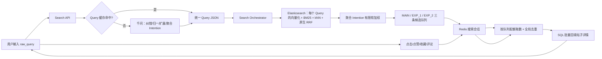

# Nalook 搜索系统离线与在线全链路方案 v0.1

> 文档状态：第一版可实施方案  
> 适用范围：普通内容搜索，不包含作者搜索、账号搜索和搜索广告  
> 前置假设：所有帖子均已拥有 `supported_intentions` 多标签；当前最可信的可检索内容是帖子 tags，后续可逐步引入标题、正文、图片理解结果等字段  
> 核心原则：先按内容召回，再用聚合 Intention 调整排序；Intention 不作为硬过滤条件

---

## 1. 本版已经确定的产品与算法决策

### 1.1 统一 Query JSON

无论 Query 精准还是模糊，大模型必须输出同一种结构：

```json
{
  "query": "纠错和归一后的标准 Query",
  "expansion_queries": [
    "扩展 Query 1",
    "扩展 Query 2"
  ],
  "intentions": [
    "聚合 Intention 1",
    "聚合 Intention 2"
  ]
}
```

字段定义：

- `query`：对原始 Query 进行纠错和归一后的标准表达，不得虚构用户没有给出的地点、价格、品牌、人群等约束。
- `expansion_queries`：所有扩展方向等权，不要求大模型输出 boost。
  - 对明确 Query，扩展以同义表达、别名、词汇变化和搜索表达变化为主。
  - 对模糊 Query，扩展可以探索若干合理方向，帮助用户获得更全面的结果。
  - V1 固定要求 2 条有效 expansion，因此正常情况下形成 `MAIN + EXP_1 + EXP_2` 三条 Query 候选队列。
- `intentions`：对用户可能目的的聚合描述，不与某一条 expansion 一一绑定，也暂不要求大模型给权重。
- `raw_query` 不需要放在大模型返回 JSON 中，但业务服务必须原样保存，供日志、排障和重放使用。

`intentions` 数量通常能反映 Query 的开放程度，但不能被当作唯一的“精准/模糊分类器”。例如一个长 Query 也可能同时具有“了解、决策、解决问题”多个合理目的。

### 1.2 召回和排序原则

1. 原始标准 Query 与每条 expansion 都独立执行：关键词召回、向量召回、Query 内部 RRF。
2. 每条 Query 最终形成一条候选队列，不立即把所有 Query 合并成一个总榜。
3. Intention 不参与硬过滤，避免候选被过滤为空，也避免帖子标签错误导致相关内容丢失。
4. Intention 在召回后只做有上限的软加权：V1 命中任一聚合 Intention 时在 RRF 分数上乘以 `1.05`，未命中的帖子完整保留。
5. 第一页各 Query 队列等权取数；后续页根据当前搜索会话中的有效行为动态改变各队列取数频率。
6. 动态反馈只影响尚未展示的候选，不回头改变用户已经看过的结果。

### 1.3 本版不做的事情

- 不让大模型生成 Query boost、Intention 权重或最终搜索分数。
- 不用 Intention 先过滤整个索引。
- 不把搜索会话的临时权重写回 Elasticsearch。
- 不让 ES 负责千问 Query 改写、会话状态、行为归因或跨 Query 多队列编排；Query 与帖子 Embedding 由 ES Inference 负责。
- 暂不做复杂 LTR、长期用户画像和跨搜索会话个性化。

---

## 2. 系统边界与组件职责

| 组件 | 负责 | 不负责 |
|---|---|---|
| Query Rewrite Service | 调用千问；纠错、归一、扩展、聚合 Intention；严格 JSON 校验 | ES 分词、BM25、向量近邻搜索 |
| ES Inference / Embedding 模型 | 在帖子入库时生成 `tag_embedding`；在查询时由 `query_vector_builder` 生成 Query 向量 | 生成 Intention、业务排序 |
| Search Orchestrator | 并发发送多 Query 的 ES 混合检索；Intention 软加权、跨 Query 队列取数、去重、补量 | 每 Query 内部的 BM25/kNN RRF、保存帖子权威业务数据 |
| Elasticsearch | 中文分析、倒排索引、Query Embedding、BM25、向量 kNN、每 Query 原生 RRF、过滤合法状态和基础质量/时间字段 | Query 改写、维护搜索会话、根据行为实时改变队列比例 |
| Redis | Query 改写缓存、搜索会话、已曝光集合、队列游标和动态分数 | 帖子长期权威存储 |
| SQL | 帖子权威数据、tags、`supported_intentions`、帖子详情 | 高频搜索排序计算 |
| Event Service / MQ | 接收并去重搜索行为事件，更新当前会话，沉淀离线日志 | 直接修改 ES `_score` |

一句话概括：**千问在 ES 外完成 Query 改写；ES 完成 Query 向量化、BM25、kNN 与每 Query 原生 RRF；搜索服务做跨 Query 队列编排；Redis 保存当前搜索会话；SQL 提供最终帖子详情。**

---

## 3. 总体架构



---

## 4. 数据模型设计

### 4.1 SQL 帖子侧

假设已完成 Intention 标签，建议至少保留：

```text
post
  id
  code
  title
  content
  status
  prepared_by
  prepared_datetime
  type
  ...

post_tag
  post_id
  tag

post_intention
  post_id
  intention_code
  intention_version
  source              # manual / model / rule
  created_at
```

建议用独立 `post_intention` 表，而不是逗号字符串。这样可版本化、增删单一标签、审计标注来源，并方便重新同步 ES。

帖子可以有多个 `supported_intentions`，本版不区分 primary/secondary，也不预设帖子 Intention 权重。

### 4.2 Elasticsearch v2 索引

当前 Nalook 的 `EsPost` 中标题、正文主要是 `keyword`，当前搜索又以 wildcard 为主，不等价于正式的 BM25 搜索。建议新建版本化索引，再通过 alias 切换，不直接破坏旧索引。

示例结构如下；中文 analyzer 必须依据阿里云 ES 已安装插件确定，下面的 `nalook_cn` 是逻辑名称，不代表插件已经存在：

```json
PUT nalook_post_search_v2
{
  "settings": {
    "analysis": {
      "analyzer": {
        "nalook_cn": {
          "type": "standard"
        }
      }
    }
  },
  "mappings": {
    "properties": {
      "post_id": { "type": "long" },
      "code": { "type": "keyword" },
      "title": {
        "type": "text",
        "analyzer": "nalook_cn",
        "fields": { "raw": { "type": "keyword" } }
      },
      "content": {
        "type": "text",
        "analyzer": "nalook_cn"
      },
      "tags": { "type": "keyword" },
      "tags_text": {
        "type": "text",
        "analyzer": "nalook_cn"
      },
      "supported_intentions": { "type": "keyword" },
      "tag_embedding": {
        "type": "dense_vector",
        "dims": 1024,
        "index": true,
        "similarity": "cosine"
      },
      "prepared_datetime": { "type": "date" },
      "status": { "type": "keyword" },
      "quality_score": { "type": "float" },
      "like_count": { "type": "long" },
      "favorite_count": { "type": "long" },
      "visit_count": { "type": "long" }
    }
  }
}
```

注意：

- `dims` 必须与最终选择的 Embedding 模型一致，不能照抄示例值。
- `tags` 用于精确过滤、展示、行为归因；`tags_text` 用于分词和 BM25。
- 初期只有 tags 可用时，BM25 重点搜索 `tags_text`；标题和正文可以先降低权重，质量验证后再逐步加入。
- `tag_embedding` 是对帖子所有有效 tags 组成的一个整体搜索表达生成的向量，而不是对每个词向量简单求和。
- Intention 不应混入 `tag_embedding`，否则内容相似度和用户目的相似度被混在同一个不可解释的分数中。
- 上线前必须用 `_analyze` 检查中文、英文、数字、品牌词和专有名词的真实分词效果。

### 4.3 帖子 Embedding 输入

离线为每篇帖子构建稳定、可重放的文本：

```text
标签：露营装备；帐篷；睡袋；亲子露营；户外
```

处理规则：

1. Unicode、全半角、大小写、空格和常见符号归一。
2. 删除完全重复的 tags。
3. 过滤平台无意义泛词、作弊词和纯噪声。
4. 保留原始有序 tags，同时记录 `tag_normalization_version`。
5. 入库时由 ES Ingest Pipeline 调用 `ops-text-embedding-002`，一次编码整段结构化文本并写入 `tag_embedding`。
6. 帖子和在线 Query 必须使用同一模型、同一向量维度和相同归一化方式。

如果模型输入过长，再按信息量截断；不要在第一版引入“每个词向量求和”，因为简单求和会丢掉上下文、词序和组合语义，而且高频泛词容易支配最终向量。

### 4.4 Redis 搜索会话

建议 key：`search:session:{search_session_id}`，TTL 从最后一次操作开始延长 30 分钟。

```json
{
  "session_id": "s_123",
  "user_id": "u_456",
  "raw_query": "杭洲有什么适合大人带小孩的露营地",
  "query_json": {
    "query": "杭州适合大人带小孩出行的露营地",
    "expansion_queries": [
      "杭州亲子露营地",
      "杭州家庭露营地点推荐"
    ],
    "intentions": ["LOCATE", "DECIDE", "SOLVE"]
  },
  "query_model_version": "qwen_rewrite_v1",
  "embedding_model_version": "embedding_v1",
  "queues": {
    "main": { "position": 10, "source_score": 0.0 },
    "expansion_1": { "position": 10, "source_score": 0.0 },
    "expansion_2": { "position": 10, "source_score": 0.0 }
  },
  "intention_scores": {},
  "item_rewards": {},
  "shown_item_ids": [],
  "event_ids": [],
  "created_at": 0,
  "last_active_at": 0
}
```

候选 ID 列表可拆成 Redis List/ZSet，避免一个 JSON 被频繁整体覆盖。会话的含义不是永久用户画像，而是：**只记录用户在这一次搜索中看到了什么、反馈了什么、接下来各候选队列应当多取还是少取。**

---

## 5. 离线链路

### 5.1 Intention 体系治理

虽然本方案假设帖子已打好标签，离线仍要维护：

- `intention_code`：稳定英文枚举，展示名可变化。
- `intention_version`：分类体系或标注 Prompt 改变时升级。
- 多标签数量上限：防止模型给所有帖子都打满标签。
- 标注互斥/共存规则：仅用于质检，不应在搜索时做生硬过滤。
- 抽样人工验收：按类别、作者、内容域、热门度分层抽样。
- 标签分布监控：某一标签突然覆盖绝大多数帖子通常意味着 Prompt 或数据异常。

### 5.2 Tag 清洗与质量治理

建立离线字典和规则：

- 同义归一：如不同大小写和全半角写法。
- 别名保留：规范 tag 用于归因，别名可进入 `tags_text` 扩大词汇召回。
- 泛词降权或剔除：例如没有内容区分度的平台公共词。
- 异常检测：过长 tag、URL、联系方式、重复堆叠和营销作弊词。
- 每次产出 `tag_quality_version`，支持重新索引和效果回溯。

### 5.3 帖子向量生产

全量任务：

1. SQL 分批读取有效帖子及 tags。
2. 生成规范化 `tags_text`，Bulk 文档本身不携带 `tag_embedding`。
3. 建立 ES `text_embedding` Ingest Pipeline，输入 `tags_text`，输出 `tag_embedding`，模型为 `ops-text-embedding-002`。
4. 通过 `_bulk?pipeline=<pipeline_name>` 写入新索引，由 ES 在入库过程中生成 1024 维向量。
5. 导入完成后分别核对文档总数和 `exists(tag_embedding)` 数量，并抽样执行 kNN 验收。
6. 记录 Pipeline、模型、维度、tags 规范化版本和内容 hash，支持重建与审计。

增量任务：

- 新帖子、tags 变化时发出 `post_search_changed` 事件，并通过同一 Ingest Pipeline 写入 ES。
- 只有规范化 tags hash 发生变化才让帖子重新经过向量化 Pipeline。
- Intention 单独变化时只更新 `supported_intentions`，无需重算内容向量。
- 更新失败进入重试队列和死信队列，不阻断帖子主业务发布。

### 5.4 ES 全量重建与增量同步

建议流程：

1. 建 `nalook_post_search_v2_YYYYMMDD`。
2. 全量同步 SQL + tags + intentions，通过 Ingest Pipeline 在 ES 内生成 embedding。
3. 检查文档总数、随机抽样字段、分词、BM25、kNN 和延迟。
4. 开启旧索引和新索引的短期双写。
5. Shadow 流量同时查询新旧索引，记录差异但只返回旧结果。
6. 通过 alias 原子切换读流量。
7. 保留旧索引一段回滚窗口后再人工删除。

### 5.5 离线评估数据集

至少建立三类 Query：

- 精准：品牌/型号/规格、具体地点、明确问题。
- 模糊：露营、装修、摄影、求职等开放主题。
- 异常：错别字、拼音、英文混写、口语、重复字符、无意义 Query。

每条 Query 至少标注：相关等级、可接受 Intention、是否应纠错、扩展是否越界。建议指标：

- Query 改写正确率、扩展越界率、JSON 合法率。
- Recall@K：相关帖子是否进入候选池。
- nDCG@10 / nDCG@20：高相关帖子是否靠前。
- MRR：明确答案型 Query 的第一个相关结果位置。
- Intent Coverage：模糊 Query 首屏是否覆盖多个合理方向。
- Duplicate Rate：首屏重复主题/重复帖比例。
- 零结果率、候选不足率。

### 5.6 离线参数调优

首版参数必须作为配置，而不是写死在代码：

```yaml
search:
  expansion_count: 2
  lexical_size_per_query: 200
  vector_k_per_query: 200
  vector_num_candidates: 1000
  rrf_rank_constant: 60
  rrf_window_size: 200
  intention_match_boost: 0.05
  queue_profile_window: 50
  page_size: 30
  session_ttl_minutes: 30
  exploration_ratio: 0.20
```

以上只是合理起点，必须用离线标注集和线上 A/B 调整。尤其 `k`、`num_candidates` 和 pool 大小会显著影响延迟和召回率。

---

## 6. 在线首搜链路

### 6.1 请求进入与基础校验

`POST /api/search`

```json
{
  "query": "杭洲有什么适合大人带小孩出行的露营地吗",
  "page_size": 30,
  "client_request_id": "req_123"
}
```

搜索服务执行：

1. 去除控制字符和首尾空白，限制最大字符数。
2. 保留 `raw_query`，生成 `normalized_cache_key`。
3. 创建 `search_session_id`。
4. 记录用户、设备、实验桶、时间和请求链路 trace ID。
5. 空 Query 走热搜/推荐链路，不调用改写模型。

### 6.2 大模型 Query 改写

先查 Redis：`query:rewrite:{model_version}:{hash(raw_query)}`。未命中才调用千问。

调用建议：

- 关闭 thinking/reasoning。
- temperature 设为 0 或极低。
- 严格 JSON schema，只允许三个字段。
- 固定要求 2 条有效 expansion，并限制每条字符串长度。
- 设置短超时，最多一次快速重试；重试仍失败立即降级。
- 记录输入/输出 token、首 token 时间、总耗时、模型版本和缓存命中。

服务端校验：

- `query` 非空。
- expansion 去空、去重，且不能与 `query` 完全相同。
- Intention 必须属于预定义枚举。
- 删除明显凭空增加硬条件的 expansion。
- 结果序列化后写入缓存。

降级结果：

```json
{
  "query": "经过本地字符归一的原始 Query",
  "expansion_queries": [],
  "intentions": []
}
```

因此大模型故障不会使搜索不可用，只会暂时失去扩展和 Intention 能力。

### 6.3 ES 内 Query Embedding

Search Orchestrator 不在应用层先生成或拼接向量。它为标准 Query 与每条 expansion 分别发送一条 ES 原生 RRF 请求，并在各自的 `knn retriever` 中使用：

```json
{
  "query_vector_builder": {
    "text_embedding": {
      "model_id": "ops-text-embedding-002",
      "model_text": "杭州亲子露营地"
    }
  }
}
```

ES 通过 Inference API 为每条 Query 生成独立向量。MAIN、EXP_1、EXP_2 三个请求并发执行，不能把多个 Query 拼成一个字符串只生成一个向量，否则会失去独立候选队列和行为归因能力。

若某一条混合请求因 Embedding 限流或暂时故障失败，该 Query 最多快速重试一次，仍失败则降级为 BM25-only；其他 Query 队列不受影响。当前直接使用 `query_vector_builder` 的方案不会向应用层返回 Query 向量，因此候选池补量再次请求 ES 时会再次调用模型；若后续成本或限流成为主要问题，再评估拆分 `_inference` 调用并缓存 Query 向量。

### 6.4 每个 Query 的关键词召回

初期重点检索 tags：

```json
{
  "size": 200,
  "query": {
    "bool": {
      "must": [
        {
          "multi_match": {
            "query": "杭州亲子露营地",
            "fields": [
              "tags_text^4",
              "title^1.5",
              "content^0.5"
            ],
            "type": "best_fields"
          }
        }
      ],
      "filter": [
        { "term": { "status": "NORMAL" } }
      ]
    }
  }
}
```

说明：

- `filter` 仅用于帖子状态、权限、内容安全、地域硬约束等确定条件，不用于聚合 Intention。
- 不再用 wildcard 作为主召回方式。
- 不用 `boost_mode=replace` 覆盖相关性分数，否则 BM25 计算失去意义。
- 质量、时效等业务分数可在粗排阶段小幅融合，不能完全盖过内容相关性。

### 6.5 每个 Query 的向量召回

逻辑示例：

```json
{
  "retriever": {
    "rrf": {
      "retrievers": [
        {
          "standard": {
            "query": {
              "multi_match": {
                "query": "杭州亲子露营地",
                "fields": ["tags^5", "tags_text^4", "title^2", "content^0.5"]
              }
            }
          }
        },
        {
          "knn": {
            "field": "tag_embedding",
            "query_vector_builder": {
              "text_embedding": {
                "model_id": "ops-text-embedding-002",
                "model_text": "杭州亲子露营地"
              }
            },
            "k": 200,
            "num_candidates": 1000
          }
        }
      ],
      "rank_constant": 60,
      "rank_window_size": 200
    }
  }
}
```

上面省略了完整 `multi_match` 与过滤条件，只展示请求的组合关系。向量召回解决“词面不一致但语义相关”的问题；BM25 保证专有词、型号、精确 tags 等词面匹配。两路都要保留，并由同一次 ES 请求内的原生 RRF 融合。

### 6.6 每个 Query 内部 RRF

每条 Query 分别得到：

- `lexical_ranked_list`
- `vector_ranked_list`

RRF 不直接比较 BM25 分数和余弦分数，而只使用名次：

```text
RRF(item) = Σ 1 / (rank_constant + rank_in_channel)
```

若 `rank_constant=60`：

- 帖子 A 在 BM25 第 1、kNN 第 10：`1/61 + 1/70`
- 帖子 B 仅在 BM25 第 2：`1/62`
- 帖子 C 仅在 kNN 第 1：`1/61`

同时被两路稳定召回的 A 通常会超过只在单路靠前的帖子。RRF 的优势是无需把不同量纲的 `_score` 强行归一。

本项目已经在阿里云 ES Serverless 8.17 实例验证原生 `rrf retriever` 可用，因此确定由 ES 完成每条 Query 内部的 BM25 与 kNN 融合。搜索服务对 MAIN、EXP_1、EXP_2 各发出一次混合检索请求，每次请求内部结构为：

```text
standard retriever（BM25） + knn retriever（向量） → rrf retriever
```

ES 直接返回该 Query 的一条融合候选队列和 RRF `_score`。Search Orchestrator 不再分别拉取两份结果自行计算 RRF，只继续负责 Intention 小幅加权、跨 Query 去重、配额编排与会话反馈。三个 Query 不能再被合成一个总 RRF 请求，否则会失去独立候选队列和行为归因能力。参考：[Elasticsearch RRF](https://www.elastic.co/docs/reference/elasticsearch/rest-apis/reciprocal-rank-fusion)。

### 6.7 聚合 Intention 软排序

对每条 Query 的 RRF 队列计算是否命中聚合 Intention：

```text
matched = item.supported_intentions ∩ query_json.intentions 非空
```

Intention 只能在 RRF 相关性分数上做有上限的小幅乘法加权，首版定义为：

```text
intention_boost = 0.05 if intention_matched else 0
ranking_score = rrf_score × (1 + intention_boost)
```

不能把 `intention_matched` 作为比分数更靠前的第一排序键。那样看似是“软排序”，实际会让所有泛化的 Intention 命中帖整体压过词面和语义高度相关的帖子。5% 只是实验初值，必须配置化并通过离线标注集和线上 A/B 调整。本版不根据命中数量额外加分，避免一个被打了很多 Intention 的帖子天然占优。

如果 `query_json.intentions` 为空，跳过本步骤。未命中的帖子始终保留，只是没有获得 5% 的实验性加权，因此不会因为 Intention 造成空结果。

### 6.8 建立候选队列

V1 固定使用 1 条标准 Query + 2 条有效 expansion，因此正常情况下建立三条 Query 候选队列：

```text
MAIN
EXP_1
EXP_2
```

这里的“三条队列”不是指每个 Query 有三条队列。每条 Query 都通过一次 ES 原生 RRF 请求在内部完成 BM25 与 kNN 融合：标准 Query 对应 MAIN，两条 expansion 分别对应 EXP_1、EXP_2。若大模型降级、某条 expansion 校验失败或对应队列完全为空，系统允许临时少于三条活跃队列，并把空缺配额分给其余队列。

每个候选记录至少保存：

```json
{
  "post_id": 10001,
  "rrf_score": 0.031,
  "ranking_score": 0.03255,
  "intention_matched": true,
  "source_query": "expansion_1",
  "retrieval_method": "es_native_rrf",
  "tags": ["露营装备", "帐篷"],
  "supported_intentions": ["DECIDE", "SOLVE"]
}
```

同一帖子可能出现在多个队列中，队列内先保留它。组装页面时先汇总各队列候选，再按 `post_id` 合并，同时保存它在所有来源 Query 中的队列名、队内排名、RRF 分数和 `es_native_rrf` 检索方式。去重后为它分配一个 `allocated_queue`，这个字段只表示它占用了哪条队列的页面配额，不直接决定行为奖励归属。

### 6.9 第一页编排

V1 的 `page_size` 固定为 30，正常情况下共有 `MAIN + EXP_1 + EXP_2` 三条 Query 候选队列。第一页尚无用户反馈，三条队列等权，因此目标配额固定为每条 10 个。不能按 `MAIN → EXP_1 → EXP_2` 的固定顺序边取边去重，否则多来源帖子会系统性占用靠前队列的名额。

取数规则：

1. 每条队列先提交 `目标配额 + buffer` 个候选，例如目标配额 10、buffer 取 10，则每条队列先提交 20 个。
2. 将所有候选按 `post_id` 合并，得到唯一帖子及其完整 `source_queries`。
3. 对唯一帖子聚合各来源 Query 的 `ranking_score`，首版使用求和得到 `cross_query_score`，并按该分数降序选择帖子。帖子同时被多个改写 Query 找到是相关性的正向证据，不能因为它是多来源帖子而降低优先级。
4. 单来源帖子只能占用自己的队列配额，但不享受额外优先权。多来源帖子分配给当前配额完成比例最低的来源队列；若相同，选择该帖子队内排名更高的队列；再次相同时使用基于 `session_id + page_no` 的轮转顺序打破平局。
5. 某队列不足时，剩余配额按当前权重分给其他队列。
6. 对选出的唯一帖子进行平衡穿插，避免页面展示顺序永远由 MAIN 开始。
7. 批量用 ID 从 SQL 回填帖子完整数据；已删除、不可见或状态变化的帖子跳过并继续补足。
8. 把最终展示顺序、`allocated_queue`、全部 `source_queries` 和检索方式写入曝光归因数据。

例如帖子 X 同时来自 MAIN、EXP_1 和 EXP_2，合并后的归因数据可以是：

```json
{
  "post_id": 10001,
  "source_queries": [
    { "queue": "main", "rank": 12, "rrf_score": 0.022 },
    { "queue": "expansion_1", "rank": 1, "rrf_score": 0.031 },
    { "queue": "expansion_2", "rank": 3, "rrf_score": 0.028 }
  ],
  "allocated_queue": "expansion_1"
}
```

`allocated_queue` 只用于页面配额记账。它不表示用户一定偏爱该 Query，也不应因为程序分配顺序而独占用户奖励。

上述顺序非常关键：不能先把单来源帖子填满配额，再处理多来源帖子。实验中，杭州露营类高相关帖子往往同时被 MAIN、EXP_1、EXP_2 找到；若单来源优先，反而会让只被某一个扩展 Query 偶然召回的展览、书籍等弱相关帖子进入首页。

可以直接复用 Nalook 推荐流现有 `assembleThreeChannel` 的思想，把 `INIT/EXP/RAND` 改造为 `MAIN/EXP_1/EXP_2/...`，并将固定 ratio 改为会话动态 quota。

---

## 7. 搜索会话中的行为反馈与下一页调整

### 7.1 什么是有效行为

建议第一版事件及基础奖励：

| 行为 | reward |
|---|---:|
| 点击进入 | +1 |
| 点赞 | +2 |
| 收藏 | +3 |
| 评论 | +3 |

这四类行为都能在当前 Nalook 代码中找到对应动作：点击对应帖子 `VISIT`，点赞对应 `LIKE`，收藏对应 `FAVORITE`，评论对应帖子或评论链路中的 `REPLY`。虽然当前 `DocumentAction` 还定义了分享、附件访问等其他动作，但搜索反馈 V1 明确不接入。

同一用户对同一帖子在同一搜索会话中，每一类正向行为最多计分一次；同一个帖子的累计 reward 截断到 `[0, +5]`，避免点击、点赞、收藏和评论叠加后过度放大。取消点赞、取消收藏或删除评论只用于撤销此前相应奖励，不作为新的负向行为。以上数值是可调系统参数，不是大模型输出。

### 7.2 一个行为反馈给哪两个对象

事件示例：

```json
{
  "event_id": "evt_789",
  "search_session_id": "s_123",
  "item_id": 10001,
  "event_type": "favorite",
  "position": 7,
  "allocated_queue": "expansion_1",
  "source_queries": [
    { "queue": "main", "rank": 8 },
    { "queue": "expansion_1", "rank": 2 }
  ],
  "retrieval_method": "es_native_rrf",
  "item_intentions": ["DECIDE", "SOLVE"],
  "timestamp": 0
}
```

收到 reward `r` 后：

### A. 来源 Query 队列

如果帖子只有一个来源 Query，完整奖励该队列：

```text
queue_source_score[source_queue] =
    0.8 × old_score + r
```

如果帖子来自 `n` 个 Query，它不能清楚区分用户偏爱哪个方向，因此先对 Query 方向奖励做歧义折扣，再平均分给全部来源：

```text
Query 方向总奖励 = r / n
每条来源 Query 的奖励 = r / n²

queue_source_score[q] =
    0.8 × old_score + r / n²
```

例如收藏奖励为 `+3`：单来源帖子给该队列 `+3`；三来源帖子的 Query 方向总奖励降为 `+1`，三条来源各得约 `+0.33`。这样既不会把一次行为重复放大，也不会让固定取数顺序偏袒 MAIN。多来源越多，帖子越不适合用来判断具体 Query 方向。

### B. Item Intention

先计算：

```text
matched_intentions = item_intentions ∩ query_json.intentions
```

若有 `n` 个交集，每个获得 `r/n`：

```text
intention_score[i] = 0.8 × old_score + r / n
```

如果无交集，不更新 Intention 分数；不能因为帖子没有被现有聚合 Intention 覆盖就凭空创建一个 Query Intention。

`0.8` 是会话内衰减，使新行为比很早的行为更能影响后续页面，也防止分数无限累积。

Tags 仍用于 BM25、向量召回和结果解释，但由于 tag 质量、粒度和泛化程度不稳定，本版不根据用户行为维护 `tag_score`，也不让 tag 反馈参与动态队列配额。

### 7.3 从两类反馈计算队列价值

每次准备下一页时，查看每个队列接下来约 50 个未展示候选，计算：

```text
intent_affinity(queue)
  = 候选 supported_intentions 对当前 intention_scores 的平均匹配值

utility(queue)
  = 1.0 × queue_source_score
  + 0.5 × intent_affinity(queue)
```

再转成非零权重：

```text
raw_weight(queue) = clamp(1 + 0.2 × utility(queue), 0.5, 3.0)
```

系数 `1.0 / 0.5 / 0.2` 都是系统配置，需要离线回放和 A/B 调整。设计上单来源 Query 是最明确的方向信号，多来源 Query 经歧义折扣后影响较小，Intention 负责让相同目的的候选队列获得间接反馈。

### 7.4 保留探索比例

不能把所有取数都给目前最高分队列。最终概率采用：

```text
final_probability
  = 20% × uniform_probability
  + 80% × normalized_feedback_weight
```

只要活跃队列还有候选，尽量保证每页至少取 1 条。这样用户早期一次误点不会让其他方向永久消失，也能继续收集反馈。

例：page size 30，三条队列第一页各取 10 条；用户后续连续收藏 EXP_2 中的“装备”内容后，下一页可以变为：

```text
MAIN          8
EXP_1 地点    8
EXP_2 装备   14
```

这里改变的是 **Search Orchestrator 从各候选队列取多少条**，不是修改 ES 原始 `_score`，也不是重新给已经展示的帖子排序。

### 7.5 事件工程细节

- 以 `event_id` 幂等，重复上报只处理一次。
- 点击、点赞、收藏、评论分别按 `search_session_id + item_id + event_type` 去重，同类重复操作不重复加分。
- 点赞后取消、收藏后取消、评论删除应发撤销事件，只抵消此前对应 reward；重复撤销不得产生负分。
- 评论或回复必须解析到所属根帖子 `post_id`，反馈计入搜索结果中的帖子，而不是单独给评论对象建立候选队列。
- 服务端从会话保存的归因数据取 Intention 和队列来源，不信任客户端随意提交这些字段。
- Redis 更新使用 Lua 或事务，保证事件去重与分数修改原子完成。
- 所有事件同时写入 MQ/日志供离线回放，Redis 只保存当前会话的即时状态。

---

## 8. 普通翻页与候选补量

### 8.1 普通向下滑动加载下一页

`POST /api/search/next`

```json
{
  "search_session_id": "s_123",
  "cursor": "opaque_cursor",
  "page_size": 30
}
```

处理：

1. 从 Redis 读取会话，校验用户和 cursor。
2. 汇总已到达的有效行为事件。
3. 计算各队列动态权重和本页整数配额。
4. 从现有候选池继续取数、去重并回填 SQL。
5. 更新各队列 position、shown IDs 和下一个 cursor。
6. 不重新调用千问；只要现有候选池足够，本页也不请求 ES，因此不会再次调用 Query Embedding。
7. 只有当某条 Query 候选池已经无法继续满足取数配额时，才对该 Query 去 ES 补召回。

整个搜索会话采用“先召回一批、持续消费、用完再补”的方式：

```text
首次搜索
  → MAIN、EXP_1、EXP_2 各召回一批候选帖子
  → 保存到搜索会话候选池
  → 每次翻页按当前动态配额消费候选
  → 某条队列候选用完或不足以完成本页配额
  → 只为该 Query 向 ES 补充下一批候选
  → 继续消费
```

如果用户修改 Query，即使只改一个词，也创建新的 search session，不继承当前会话即时反馈；长期用户偏好属于后续版本。

### 8.2 候选池补量

当某条队列已经用完，或剩余候选无法满足本页分配给它的配额时：

- 只对不足的 Query 重新发送 ES 原生 RRF 请求，在受控范围内扩大 `k`、`num_candidates` 和 `rank_window_size`，并排除已展示及候选池中已有的 ID。
- ES 在同一请求内重新执行 BM25、Query Embedding、kNN 与 RRF，Search Orchestrator 只对新增候选执行 Intention 软加权和跨 Query 去重。
- 补量不重新调用千问；当前 `query_vector_builder` 会再次产生一次 Query Embedding 模型调用，这一成本必须计入监控。
- 若该 Query 已经无法召回新的唯一帖子，则将队列标记为耗尽，并把它的配额转给其他队列。

参考：[Elasticsearch search_after](https://www.elastic.co/docs/reference/elasticsearch/rest-apis/paginate-search-results)、[Point in time](https://www.elastic.co/guide/en/elasticsearch/reference/current/point-in-time-api.html)。

---

## 9. API 契约

### 9.1 首搜响应

```json
{
  "search_session_id": "s_123",
  "cursor": "opaque_cursor_1",
  "query": {
    "raw": "杭洲有什么适合大人带小孩出行的露营地吗",
    "canonical": "杭州适合大人带小孩出行的露营地"
  },
  "items": [
    {
      "id": 10001,
      "code": "post_xxx",
      "title": "杭州亲子露营地实测",
      "tags": ["杭州露营", "亲子露营"]
    }
  ],
  "has_more": true
}
```

客户端不需要看到 expansion、内部 Intention、RRF 分数和队列权重。调试环境可以通过受控 debug 字段返回，生产普通用户响应不暴露这些内部信息。

### 9.2 行为事件接口

`POST /api/search/event`

客户端最少提交：

```json
{
  "event_id": "evt_789",
  "search_session_id": "s_123",
  "item_id": 10001,
  "event_type": "favorite",
  "position": 7,
  "client_timestamp": 0
}
```

`event_type` 在搜索反馈 V1 中只允许 `click`、`like`、`favorite`、`comment`。取消点赞、取消收藏和删除评论属于对应状态的撤销同步，只抵消已经记入的奖励，不扩展新的偏好类型。

服务端根据 session 补齐 `allocated_queue`、完整 `source_queries`、检索方式和 Intention，避免客户端伪造归因信息。Tags 可以保留在普通搜索日志中，但不进入会话行为打分。

### 9.3 Cursor

Cursor 应是不透明且签名的 token，内部可以包含：

- session ID
- page sequence
- server-side state version
- expires_at

客户端不能自己提交每条队列 position。重复 cursor 请求应返回同一页或明确拒绝，防止网络重试造成结果跳页。

---

## 10. 在线伪代码

### 10.1 首搜

```python
def first_search(raw_query, user_id, page_size=30):
    session_id = new_session_id()
    query_json = query_rewrite_cache.get(raw_query)
    if query_json is None:
        query_json = rewrite_with_qwen(raw_query)
        query_json = validate_or_fallback(query_json, raw_query)
        query_rewrite_cache.put(raw_query, query_json)

    texts = [query_json.query] + query_json.expansion_queries
    queues = {}
    for index, text in enumerate(texts):
        try:
            fused = es_native_rrf_with_query_vector_builder(text)
        except TransientEmbeddingOrEsError:
            fused = es_bm25_only(text)
        queues[queue_name(index)] = bounded_intention_boost(
            fused, query_json.intentions, boost=0.05
        )

    session = create_session(session_id, raw_query, query_json, queues)
    quotas = equal_quotas(active_queues(session), page_size)
    selected = collect_merge_and_fair_allocate(session, quotas)
    items = sql_batch_hydrate_and_refill(selected, page_size)
    save_session(session)
    return build_response(session, items)
```

### 10.2 行为更新

```python
def on_search_event(event):
    session = redis.get(event.session_id)
    attribution = session.item_attribution[event.item_id]
    if not event_is_new_and_valid(event, session):
        return

    reward_delta = validated_reward_delta(event, session)
    old_item_reward = session.item_reward.get(event.item_id, 0)
    new_item_reward = clamp(old_item_reward + reward_delta, 0, 5)
    reward = new_item_reward - old_item_reward
    if reward == 0:
        return
    session.item_reward[event.item_id] = new_item_reward

    sources = attribution.source_queries
    source_count = len(sources)
    reward_per_source = reward / (source_count * source_count)
    for source in sources:
        q = source.queue
        session.queue_score[q] = (
            0.8 * session.queue_score[q] + reward_per_source
        )

    matched = intersection(
        attribution.item_intentions,
        session.query_json.intentions
    )
    for intention in matched:
        session.intention_score[intention] = (
            0.8 * session.intention_score[intention] + reward / len(matched)
        )

    redis.atomic_save_and_mark_event_processed(session, event.event_id)
    event_log.publish(event, attribution)
```

### 10.3 下一页

```python
def next_page(session_id, cursor, page_size=30):
    session = load_and_validate(session_id, cursor)
    for queue in session.active_queues:
        queue.utility = compute_utility(queue, session, profile_window=50)
        queue.raw_weight = clamp(1 + 0.2 * queue.utility, 0.5, 3.0)

    probabilities = mix_uniform_and_feedback(
        session.active_queues,
        exploration_ratio=0.20
    )
    quotas = largest_remainder_quotas(probabilities, page_size, min_each=1)
    selected = collect_merge_and_fair_allocate(session, quotas)
    items = sql_batch_hydrate_and_refill(selected, page_size)
    save_session(session)
    return build_response(session, items)
```

整数配额建议用 largest remainder method，确保各队列配额之和严格等于 page size。

---

## 11. 排序层次与后续扩展

本版完整次序：

```text
单条 Query
  -> ES 内 Query Embedding + BM25 + kNN
  -> ES 原生 Query 内 RRF
  -> Intention 有上限的小幅加权
  -> 得到独立候选队列

多个 Query 队列
  -> 会话动态配额
  -> 轮询取数
  -> 全局去重
  -> SQL 回填
  -> 最终页面
```

后续有足够行为数据后，可以在 ES RRF 与 Intention 加权之间增加轻量粗排模型，特征包括：RRF `_score`、tag 精确命中数、时效、质量和安全分。原生 RRF 默认不返回帖子在各子检索器中的独立名次，因此不能把 BM25/kNN 单路名次当作现成在线特征；如确有需要，应另建调试采样链路。粗排后仍应保留多队列编排，避免单一总分把模糊 Query 的探索方向全部挤掉。

---

## 12. 降级与容错

| 故障 | 降级方案 |
|---|---|
| 千问超时/429/JSON 非法 | 使用本地归一后的 raw Query；无 expansion、无 Intention |
| Query Embedding 失败 | 对应 Query 仅走 BM25 |
| kNN 不可用 | 全部队列仅走 BM25；RRF 退化为单路顺序 |
| 单个 Query 的原生 RRF 请求持续失败 | 该 Query 降级为 BM25-only；其他 Query 队列继续工作 |
| Redis 会话故障 | 临时退化为无状态等权队列；客户端携带最近已展示 ID 的受限集合 |
| 某候选队列耗尽 | 将配额重新分给其他活跃队列 |
| SQL 回填缺失/不可见 | 跳过并从相同队列继续补量 |
| 事件服务积压 | 不阻断搜索；暂时沿用上一次队列权重 |
| 新索引异常 | alias 切回旧索引 |

所有外部调用都应有：明确超时、熔断、有限重试、指标和 trace，不允许搜索请求无限等待。

---

## 13. 性能与容量建议

建议首版延迟预算目标，最终以真实压测为准：

| 阶段 | 缓存命中目标 | 未命中目标 |
|---|---:|---:|
| Query 改写 | < 10 ms | 单独监控，争取 < 500 ms，超时即降级 |
| ES Query Embedding + BM25 + kNN + RRF | - | 三个 Query 并发，实验值约 200–300 ms |
| Intention + 跨 Query 队列编排 | - | < 30 ms |
| SQL 批量回填 | - | < 50 ms |

关键优化：

- 并行执行不同 Query 的 ES 请求，但设置全局并发上限。
- 每条 Query 独立发送原生 RRF 请求，三个 Query 并发执行并设置全局并发上限。
- 热门 Query 缓存改写 JSON 和短期候选池；当前不在应用层缓存 ES 内生成的 Query 向量。
- ES `_source` 只取编排所需字段。
- SQL 使用一次 `WHERE id IN (...)` 批量回填，再按搜索顺序重排。
- 普通翻页优先消费候选池，不调用千问或 ES；只有候选池不足的补量请求才会再次触发 Query Embedding。
- 固定生成 2 条有效 expansion，并对每路 pool 和最大翻页深度设置上限。

---

## 14. 监控、日志和 A/B 实验

### 14.1 系统指标

- 搜索请求量、错误率、p50/p95/p99 总延迟。
- Query 改写耗时、token、成本、429、超时、缓存命中率、JSON 非法率。
- 有效 expansion 数量（正常为 2，降级时可能少于 2）、Intention 数量分布和非法枚举率。
- ES Inference 调用次数、耗时、429、失败率和费用。
- ES 原生 RRF 请求耗时、返回候选数、降级率和慢查询。
- RRF 候选数、各队列耗尽率、补量次数。
- Intention 命中率，但不能把越高越好当作唯一目标。
- 页面重复率、SQL 回填缺失率、Redis session 命中率。

### 14.2 产品效果指标

- Search CTR、点赞率、收藏率、评论率。
- First Relevant Click / First Click Position。
- Query reformulation rate：用户很快换词通常说明当前结果不满足。
- Search abandonment：无点击退出。
- 模糊 Query 的方向覆盖率和后续方向收敛速度。
- 首屏与后续页零结果率、候选不足率。

### 14.3 必须保留的调试归因

对每次展示内部记录：

- raw/canonical/expansion 文本和模型版本。
- 所属实验桶。
- `allocated_queue`、完整 `source_queries` 及各来源队内排名。
- ES 原生 RRF `_score`；不假设在线响应能够提供 BM25/kNN 子检索的独立名次。
- Intention 是否命中。
- 页面位置、去重和补量原因。
- 当时各队列配额和权重。

这些字段用于离线回放和排障，不应全部返回客户端。

---

## 15. 安全、隐私与滥用防护

- API Key 只从服务端密钥管理或环境变量读取，不写入代码、日志或本文档。
- 发送给大模型的仅是 Query，不携带不必要的用户身份和历史隐私。
- 对日志中的手机号、邮箱、证件号等敏感 Query 做脱敏和访问控制。
- 行为事件必须校验用户、session 和 item 的归属关系，防止伪造刷权重。
- 热门 Query 缓存可跨用户复用；含明显个人敏感信息的 Query 不进入共享缓存。
- ES 召回前的状态/权限/内容安全条件属于硬过滤，Intention 不属于。

---

## 16. 分阶段上线计划

### Phase 0：数据和 Shadow

- 定稿 Intention 枚举与版本。
- 建 ES v2 mapping、tags_text 和 tag_embedding 离线任务。
- 建离线评估集。
- 新链路 Shadow 查询，不向用户展示，核对相关性、延迟和成本。

验收：数据完整、分词合理、无大规模漏索引，延迟和 ES 资源可接受。

### Phase 1：统一 Query JSON + BM25

- 上线千问统一 JSON 和缓存/降级。
- 标准 Query 与 expansions 分别走 tags BM25。
- 建独立队列、等权组装、Intention 软排序。
- 暂不上向量和行为动态调权。

验收：相对旧 wildcard 链路，零结果率下降，离线 nDCG 和线上 CTR 不下降。

### Phase 2：向量召回 + Query 内 RRF

- 上线帖子 Ingest Pipeline `tag_embedding`，Query 使用 ES `query_vector_builder`。
- 每条 Query 在 ES 内执行 `standard + knn + rrf retriever`，三个 Query 请求并发。
- A/B 比较 BM25-only 与 Hybrid。

验收：Recall@K、语义 Query 覆盖提升，延迟和成本在预算内。

### Phase 3：搜索会话与动态队列取数

- 上线 Redis session、页面展示归因记录，以及点击、点赞、收藏、评论事件；页面展示本身不计 reward。
- 首屏等权，后续页动态 quota，保留 20% 探索。
- 搜索反馈只接入点击、点赞、收藏和评论四类现有行为。

验收：后续页点击率、点赞率、收藏率或评论率提高，方向多样性没有显著下降，单次误点不会造成极端收敛。

### Phase 4：数据驱动优化

- 用日志回放调 reward、衰减、utility 系数、pool 和探索比例。
- 评估轻量粗排/LTR。
- 再讨论长期用户偏好、跨会话个性化和作者搜索独立链路。

---

## 17. 需要配置化并通过实验决定的参数

当前只确定机制，不在本版拍死以下数值：

- 两条 expansion 的具体生成质量与重复判定规则；V1 的数量固定为 2。
- Intention 是否以及何时引入细粒度权重。
- 中文 analyzer 和词典更新机制。
- Embedding 模型、维度和量化方式。
- BM25 字段 boost。
- BM25/kNN 每路候选量、RRF window 和 `rank_constant`。
- Intention 软加权系数；V1 实验初值为命中任一聚合 Intention 时乘以 `1.05`，不做命中/未命中硬分层。
- reward、衰减、队列 utility 系数和探索比例。
- session TTL、候选池大小、补量水位。
- 点击、点赞、收藏、评论的去重窗口及撤销事件规则。

这些参数应由离线数据、线上 A/B 和系统容量共同决定，不能交给大模型针对单次 Query 随意生成。

---

## 18. 第一版开发任务拆分

### A. 数据与索引

- [ ] 建 `post_intention` 或确认现有等价表及版本字段。
- [ ] 建 tag 归一任务和 `tags_text`。
- [ ] 选择 Embedding 模型并生产全量 `tag_embedding`。
- [ ] 建 ES v2 索引、同步任务、双写和 alias。
- [ ] 用 `_analyze` 与抽样 Query 验证分词和 mapping。

### B. Query 服务

- [ ] 固化千问 Prompt、统一 JSON schema 和输出校验。
- [ ] 关闭 thinking，设置超时、重试、熔断和降级。
- [ ] 建 Query rewrite cache 和 token/耗时监控。
- [ ] 接入 ES `query_vector_builder`，监控 Query Embedding 调用耗时、429、失败率与费用。

### C. Search Orchestrator

- [ ] 实现每 Query 的 ES 原生 `standard + knn + rrf retriever`，并提供 BM25-only 降级。
- [ ] 实现聚合 Intention 有上限的软加权，首版命中任一标签乘以 `1.05`。
- [ ] 实现多队列、等权首屏、全局去重和 SQL 回填。
- [ ] 保存 item attribution，为事件归因提供服务端真值。

### D. Session 与反馈

- [ ] 设计 Redis keys、TTL、cursor 和并发更新机制。
- [ ] 接入点击、点赞、收藏、评论四类搜索反馈事件，并将评论/回复归因到根帖子。
- [ ] 实现 event idempotency、reward 截断与撤销事件。
- [ ] 实现 Query 来源歧义折扣、Intention 反馈、队列 utility、动态 quota 和 20% 探索；不建立 Tag 行为分数。
- [ ] 实现普通翻页，以及候选池用完后按 Query 独立补量。

### E. 评估与上线

- [ ] 建离线 Query-Item 相关性数据集。
- [ ] 建全链路压测和故障演练。
- [ ] 建监控看板和搜索调试工具。
- [ ] 按 Phase 0–3 逐步 A/B 上线，保留旧链路回滚开关。

---

## 19. 与当前 Nalook 代码的衔接点

根据当前工程结构，建议按以下方式改造：

1. 当前 `EsPost` 新增 `tags_text`、`supported_intentions`、`tag_embedding`、状态和必要质量字段，并建立新索引，不直接在线修改旧 mapping。
2. 当前帖子同步逻辑在构造 `EsPost` 时补齐 SQL tags、`tags_text` 和 Intention，再通过带 `pipeline` 参数的 ES 写入生成 `tag_embedding`；批量或异步消费变更事件，避免发帖接口同步等待模型推理。
3. 当前 wildcard 搜索保留为短期回滚路径，新建独立 Hybrid Search 方法。
4. 推荐流已有多候选通道取配额、队列轮询、去重和 SQL 回填思想，可抽取通用 `CandidateQueueAssembler`，搜索传入动态 queue quota。
5. Search session 和反馈分数独立放 Redis/搜索服务，不扩展到 ES 文档字段。

---

## 20. 最终结论

本方案把“相关内容能不能被找到”和“用户在当前搜索会话更偏向哪个方向”分成两个问题：

- ES 的 BM25 + kNN + Query 内 RRF，负责把每个 Query 方向的相关内容找出来。
- 聚合 Intention 在召回后只做有限软加权，V1 命中时乘以 `1.05`，不能压过明显更强的内容相关性，也不消灭未命中内容。
- 多 Query 保留为独立候选队列，首屏等权，后续根据有效行为动态改变取数频率。
- Redis 只保存本次搜索的动态状态，SQL 保存权威帖子数据，ES 保存面向检索的索引，大模型只负责 Query 理解与改写。

这套结构对精准和模糊 Query 使用同一份 JSON、同一套检索算法和同一套会话机制，同时为模糊 Query 保留探索空间，也为后续基于真实数据调参和升级粗排模型留下接口。
