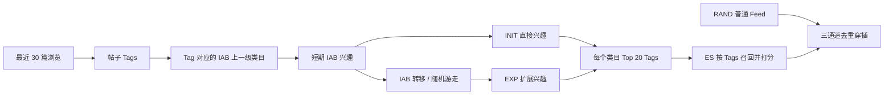
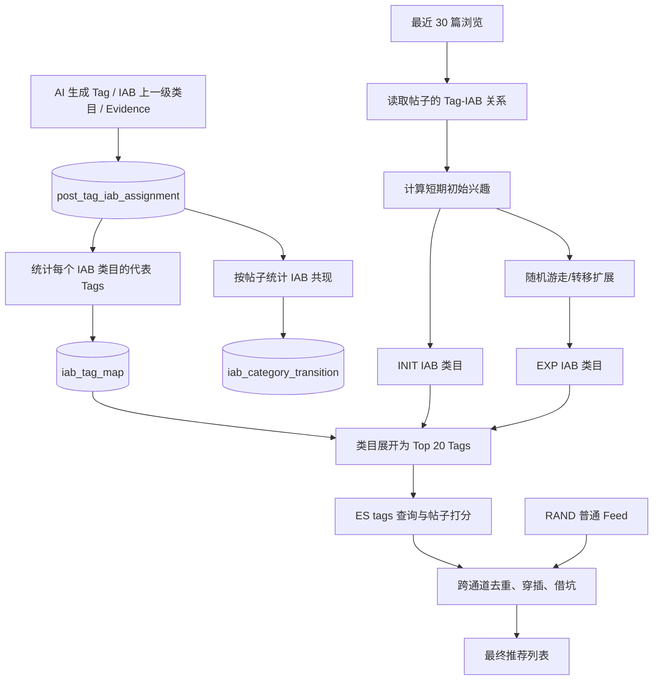

# Nalook 推荐系统方案（标签系统更新版）

> 版本：v1.3（按讨论收敛后的 MVP）  
> 日期：2026-08-24  
> 范围：首页内容推荐  
> 暂不包含：搜索、导航标签、长期兴趣、行为序列建模、复杂精排模型

## 1. 方案摘要

第一版不推倒现有推荐系统，而是替换其中的“聚类社区”概念：

- 旧方案：帖子 Tags → Tag 聚类社区 → 社区兴趣 → 社区转移 → 社区 Top 20 Tags → ES。
- 新方案：帖子 Tags → IAB 上一级类目 → IAB 短期兴趣 → IAB 转移 → IAB 类目 Top 20 Tags → ES。

用户兴趣只使用最近 30 篇浏览记录，不建立长期兴趣画像，也不接入点赞、收藏等复杂行为权重。

第一版继续保留现有工程上的代理召回方式：**一个 IAB 类目使用其 Top 20 Tags 代表，再用这些 Tags 去 ES 召回帖子。** 这样可以继续使用目前的 `EsPost.tags`、Term 查询、帖子打分和三通道组装逻辑，不必在本轮同时改造 ES 数据结构。



## 2. 现有推荐系统

当前代码中的主要链路是：

1. 读取用户最近 30 篇浏览帖子，少于 3 篇时回退普通 Feed。
2. 读取这些帖子的 Tags。
3. 通过 `community_tag_map` 把 Tag 映射到聚类社区。
4. 按浏览位置衰减，计算初始社区兴趣。
5. 通过 `community_transition` 做一跳扩展。
6. 每个社区取 Top 20 Tags。
7. 使用这些 Tags 在 ES 中召回并给帖子打分。
8. 将 INIT、EXP、RAND 三个通道去重并穿插成最终结果。

以下能力可以直接保留：

- 最近 30 篇浏览和少于 3 篇时的冷启动降级。
- 浏览位置半衰期 15。
- 兴趣权重 `0.7` 次幂软化。
- INIT、EXP、RAND 三通道。
- ES 相关性、随机性、新鲜度的组合打分。
- 超召回、跨通道去重、均匀穿插和借坑。
- 推荐总开关、三通道配比和数据集版本切换。
- 异常时回退普通 Feed。

主要替换点只有两处：

- `Tag → 聚类社区` 改为 `Tag → IAB 上一级类目`。
- `社区转移表` 改为 `IAB 类目转移表`。

## 3. IAB 类目的定义

### 3.1 每个 Tag 只关联它的上一级 IAB 类目

不再定义“最具体且有依据的 IAB 节点”，也不要求算法额外判断 IAB 应该落在哪一层。

规则直接简化为：

> 每个生成的业务 Tag，都关联一个 IAB 上一级类目；该类目可能是 IAB 一级、二级、三级或四级，推荐系统不区分它处于第几层。

例如：

```text
Tag：极简风
上一级 IAB 类目：室内设计

Tag：海军蓝
上一级 IAB 类目：家居装饰
```

对推荐系统来说，`室内设计` 和 `家居装饰` 都只是一个可计算的类目 ID。系统不再做“是否应该继续向更细一级分类”的判断。

这种方式的好处是：

- 标签生成阶段已经给出 Tag 与 IAB 类目的关系，推荐系统直接使用。
- 不需要重新定义“最具体”的判断标准。
- 不需要强制所有 Tag 都挂在同一 IAB 深度。
- 推荐算法只处理稳定的 `iab_id`，逻辑更简单。

### 3.2 一个帖子可以属于多个 IAB 类目

一个帖子有多个 Tags，这些 Tags 可以分别关联不同 IAB 类目。

例如“使用 iPhone 拍摄旅行照片的教程”可能得到：

```text
iPhone       → 智能手机类目
手机摄影     → 摄影类目
旅行摄影     → 旅行类目
拍摄教程     → 摄影类目
```

这个帖子同时属于智能手机、摄影和旅行，不需要指定唯一主类，也不需要给类目分主次。

### 3.3 IAB 层级在第一版中的作用

IAB 的父子路径仍然可以保留在 Taxonomy 表中，方便以后统计或扩展，但第一版推荐计算只使用 Tag 直接关联的上一级类目：

- 不自动补齐一级、二级祖先类目。
- 不对祖先类目追加权重。
- 不做父子类目同时计分。
- 不因为某个类目位于三级或四级就增加或减少权重。

这样能避免层级处理再次增加复杂度。

## 4. 新推荐链路



## 5. 数据结构

### 5.1 IAB Taxonomy 表

建议新增 `iab_taxonomy_node`：

| 字段 | 含义 |
|---|---|
| `iab_id` | IAB 节点 ID |
| `parent_iab_id` | IAB 原始父节点，根节点为空 |
| `name_zh` | 中文名称 |
| `name_en` | 英文名称 |
| `depth` | 原始层级，仅供查询和统计 |
| `taxonomy_version` | Taxonomy 版本 |

虽然第一版推荐算法不处理 IAB 层级，但建议保留原始父子关系，避免以后重新导入。

### 5.2 帖子 Tag-IAB 关系表

建议新增 `post_tag_iab_assignment`：

| 字段 | 含义 |
|---|---|
| `post_id` | 帖子 ID |
| `tag_name` | 业务 Tag |
| `normalized_tag_name` | NFKC、空白折叠后的 Tag |
| `iab_id` | 该 Tag 的上一级 IAB 类目 |
| `evidence` | 生成该 Tag 的内容依据 |
| `dataset_version` | 本批标签数据版本 |

不保存以下字段：

- `review_status`
- `source`
- `confidence`
- Tag 类型等额外主观字段

Evidence Judge 仍然可以在标签生成流程中使用，但 Judge 的作用是生成最终可用的数据集；推荐系统在线表不需要保存 ACCEPT、REVIEW、REJECT 等中间状态。

如果某条 Tag 或 Evidence 没有通过生成阶段的检查，就不进入最终生效的 `dataset_version`。

### 5.3 IAB 类目代表 Tag 表

建议新增 `iab_tag_map`，作用相当于现有 `community_tag_map`：

| 字段 | 含义 |
|---|---|
| `iab_id` | IAB 上一级类目 |
| `tag_name` | 归属于该类目的业务 Tag |
| `tag_quality` | 代表性分数 |
| `unique_post_count` | 包含该 Tag 的帖子数 DF |
| `dataset_version` | 数据版本 |

`tag_quality` 可以继续沿用当前公式：

```text
tag_quality = sqrt(log(1 + total_posts / (df + 5)))
              × sqrt(df / (df + 5))
```

它同时抑制两类极端 Tag：

- DF 太低、只出现一两次的 Tag，可靠性不足。
- DF 太高、几乎所有帖子都有的 Tag，区分度不足。

在线阶段按 `tag_quality DESC`，每个 IAB 类目取 Top 20 Tags。

### 5.4 IAB 类目转移表

建议新增 `iab_category_transition`：

| 字段 | 含义 |
|---|---|
| `source_iab_id` | 起始 IAB 类目 |
| `target_iab_id` | 相邻 IAB 类目 |
| `transition_probability` | 行归一化后的转移概率 |
| `cooccurrence_count` | 两个类目的共现帖子数，建议保留便于排查 |
| `dataset_version` | 数据版本 |

这张表第一版来自帖子内容共现，不来自用户的连续行为。

### 5.5 ES 第一版不增加 IAB 字段

第一版继续使用现有：

```text
EsPost.tags: keyword[]
```

新的 Tags 写入帖子并同步至 ES 后，推荐系统仍然通过 `tags` 做 Term 查询。

暂不增加：

- `direct_iab_ids`
- `iab_path_ids`
- `root_iab_ids`

这是保留“类目 → Top 20 Tags → ES”工程方式后的直接结果，也能显著缩小第一版改造范围。

## 6. 帖子的 IAB 类目权重

一个帖子可能有多个 Tags 指向同一个 IAB 类目。如果简单按 Tag 数相加，某一类目只是因为生成了更多近似 Tags 就会获得过高权重。

对帖子 `p` 和 IAB 类目 `c`：

```text
n(p,c) = 帖子 p 中关联到 c 的 Tag 数
raw(p,c) = min(n(p,c), 2)
a(p,c) = raw(p,c) / Σ_j raw(p,j)
```

含义：

- 同一类目的第一个 Tag 证明帖子属于该类目。
- 第二个 Tag 可以适度加强该类目的存在感。
- 第三个及以后不继续放大。
- 每个帖子对全部 IAB 类目的贡献之和为 1。

例如某帖有 3 个摄影类 Tags、2 个智能手机类 Tags：

```text
摄影：min(3,2) = 2
智能手机：min(2,2) = 2
帖子类目分布：摄影 0.5，智能手机 0.5
```

如果希望第一版与现有逻辑完全一致，也可以暂时不做 `min(2)` 和归一化，直接让每个 Tag 分别贡献；但建议保留上述限制，否则新 Prompt 每帖 8～9 个 Tags 后，Tag 数量会明显影响兴趣权重。

## 7. 用户短期兴趣

### 7.1 输入数据

第一版只使用：

- 用户最近 30 篇浏览帖子；
- 每篇帖子的 Tag 与 IAB 上一级类目；
- 浏览记录的新旧顺序。

暂不使用：

- 长期用户画像；
- 点赞、收藏、分享、评论等额外行为权重；
- 用户会话划分；
- 用户行为序列转移；
- 用户兴趣 Tags 持久化表。

### 7.2 时间衰减

沿用当前按帖子位置的衰减方式：

```text
decay(i) = 0.5^(i / 15)
```

其中：

- `i=0` 表示最近浏览的帖子；
- 第 15 篇帖子的权重约为最近一篇的一半；
- 第 30 篇帖子的权重约为最近一篇的四分之一。

### 7.3 初始 IAB 兴趣

用户 `u` 对类目 `c` 的原始权重：

```text
S_u(c) = Σ_p decay(index_p) × a(p,c)
```

然后继续沿用现有的 `0.7` 次幂软化：

```text
soft(c) = S_u(c)^0.7
initial(c) = soft(c) / Σ_j soft(j)
```

作用是缩小第一兴趣和其他兴趣之间的倍数差距，避免一个类目占据全部 INIT 结果。

第一版继续取 Top 6 个初始 IAB 类目，以便与现有 Top 6 社区逻辑保持一致。后续如果发现 IAB 类目更加分散，再实验 Top 8 或 Top 10。

### 7.4 冷启动

继续沿用现有规则：

- 未登录：普通 Feed。
- 最近浏览少于 3 篇：普通 Feed。
- 最近帖子没有有效 Tag-IAB 关系：普通 Feed。
- 查询或计算异常：普通 Feed。

第一版不额外构建长期兴趣或全站先验画像。

## 8. IAB 类目转移矩阵

### 8.1 转移矩阵的实际含义

第一版的 IAB 转移表继续使用帖子内部共现构建：

> 如果很多帖子同时出现 IAB 类目 A 和 B，说明 A、B 在内容主题上可能相关。

因此它更准确的含义是“IAB 内容关联图”，不是用户看完 A 后一定会看 B 的行为概率。

### 8.2 构建步骤

1. 读取所有帖子的 Tag-IAB Assignment。
2. 每个帖子内对 IAB 类目去重。
3. 统计同一帖子中出现的 IAB 类目组合。
4. 计算共现次数、置信度和 Lift。
5. 对小样本边做收缩。
6. 过滤共现次数太少的边。
7. 每个源类目保留 Top 20 相邻类目。
8. 对每个源类目按行归一化。

可以直接迁移当前 `community_transition.py` 的公式：

```text
w(A→B) = confidence(A→B)
         × min(lift(A,B), 5)^0.3
         × N(A,B)/(N(A,B)+5)
```

建议初始参数：

| 参数 | 初始值 |
|---|---:|
| 最小共现次数 | 3 |
| Lift 上限 | 5 |
| Lift 指数 | 0.3 |
| 收缩常数 | 5 |
| 每个源类目保留边数 | 20 |

## 9. 随机游走生成扩展兴趣

### 9.1 带重启随机游走

初始 IAB 兴趣向量记为 `s`，IAB 转移矩阵记为 `P`：

```text
r_(t+1) = (1-α) × s + α × r_t × P
r_0 = s
```

建议第一版：

| 参数 | 初始值 |
|---|---:|
| `α` | 0.5 |
| 收敛阈值 `epsilon` | `1e-5` |
| 最大迭代次数 | 25 |
| EXP 类目数量 | Top 6 |

带重启的意义是：扩展结果始终受用户最近 30 篇浏览形成的 `s` 约束，不会只根据全局类目图无限游走。

### 9.2 收敛速度与迭代次数

当 `P` 是非负、每行概率和为 1 的合法转移矩阵，且 `0 ≤ α < 1` 时，带重启随机游走会收敛到唯一结果 `r*`。相邻迭代相对于最终结果的误差满足：

```text
||r_t - r*||₁ ≤ α^t × ||r_0 - r*||₁
```

由于 `r_0` 和 `r*` 都是概率分布，二者的最大 L1 距离不超过 2，因此可以使用更保守的最坏情况上界：

```text
||r_t - r*||₁ ≤ 2 × α^t
```

如果要求最终误差不超过 `ε`：

```text
2 × α^t ≤ ε

t ≥ ln(ε/2) / ln(α)
```

取 `α=0.5` 时，每轮误差最多缩小一半：

| 允许的最坏 L1 误差 | 所需迭代次数上界 |
|---:|---:|
| `1e-3` | 11 |
| `1e-4` | 15 |
| `1e-5` | 18 |
| `1e-6` | 21 |

例如要求 `ε=1e-6`：

```text
t ≥ ln(1e-6 / 2) / ln(0.5)
  ≈ 20.93

向上取整为 21 轮
```

在线程序不必每次固定执行 21 轮。每轮计算相邻结果的 L1 差值：

```text
delta = Σ_i |r_next(i) - r_current(i)|
```

当 `delta < 1e-5` 时提前停止，最多执行 25 轮：

```text
r = s

for iteration in 1..25:
    next = (1-0.5) × s + 0.5 × r × P
    delta = Σ_i |next(i) - r(i)|
    r = next

    if delta < 1e-5:
        break
```

推荐只使用最终结果的 Top 6 类目，因此 `1e-5` 已足够作为第一版精度。实现时应把转移图按 `dataset_version` 加载成内存稀疏邻接表，迭代期间不得重复查询数据库。

### 9.3 INIT 与 EXP 去重

为了让 EXP 真正表示相邻兴趣：

1. 对随机游走结果按权重排序。
2. 删除已经出现在 INIT Top 6 中的类目。
3. 从剩余类目中取 Top 6 作为 EXP。
4. 对 EXP 权重重新归一化。

这与现有 `PREF_ZERO_OUT_KNOWN=true` 的做法一致。

### 9.4 随机游走不直接产生随机帖子

随机游走得到的是相对稳定的类目相关性分数。Feed 中真正的随机性仍来自：

- RAND 通道；
- ES `random_score`；
- 每次请求的随机 Seed。

## 10. 类目 Top 20 Tags 代理召回

### 10.1 为什么保留这个机制

“社区 → Top 20 Tags → ES”很可能是现有系统中的工程折中，主要便利包括：

1. ES 已经有 `tags` 字段，不需要新增社区或 IAB 字段并全量重建索引。
2. 在线查询可以继续使用已经实现的 Keyword Term 查询。
3. 社区或 IAB 权重可以转换成有限数量的 Tag Boost，直接放进 ES `function_score`。
4. 不需要在线查询某个类目下的全部帖子 ID。
5. 每个类目只展开 20 个 Tags，可以控制 ES 查询子句数量和在线延迟。
6. 可以最大程度复用当前 `queryTopTagsByCommunity()`、`expandToTagBoosts()` 和 `esPersonalized()` 的代码形态。

所以第一版继续采用：

```text
IAB 类目权重
  → 查询该类目 tag_quality 最高的 20 个 Tags
  → Tag Boost = 类目权重 × tag_quality
  → ES 匹配至少一个 Tag
  → ES 给帖子打分并返回 Top N
```

### 10.2 这个机制的限制

它是代理召回，不是完整类目召回：

- 某帖子虽然属于类目 A，但它的 Tags 都没有进入 A 的 Top 20，该帖子就不会因 A 被召回。
- 类目内部较少见的长尾主题会吃亏。
- Top 20 Tags 变化可能导致召回池随数据版本变化。

这些限制第一版可以接受，因为它换来了很小的工程改造范围。需要通过以下指标观察是否必须升级为 ES 直接 IAB 召回：

- 每个类目的 Top 20 Tags 覆盖了该类目多少帖子；
- INIT/EXP 候选枯竭率；
- 借坑率；
- 类目长尾帖曝光比例；
- Top 20、Top 30、Top 50 的覆盖率和延迟对比。

若覆盖率不足，再把 Top N 配置调大，或者第二阶段给 ES 增加 `iab_ids`。第一版不提前实施这项改造。

## 11. ES 帖子打分与三通道组装

### 11.1 不增加独立的“精排层”

现有 `esPersonalized()` 已经完成了用户所说的“给帖子打分取帖子”：

- Tag 相关性分数；
- 随机分数；
- 新鲜度分数；
- 按 `_score` 排序取 Top N。

因此第一版不再设计独立的第二次精排模型，也不另外建立复杂的用户 Tag 画像。

### 11.2 ES 内的相关性分数

对某个 IAB 类目 `c` 的代表 Tag `t`：

```text
tag_boost(t) = category_weight(c) × tag_quality(t)
```

帖子命中多个代表 Tags 时，继续使用当前 ES `function_score` 累加相关性，并叠加：

```text
post_score = tag_relevance
           + random_weight × random_score
           + freshness_weight × freshness_score
```

初始仍可沿用当前配置：

| 参数 | 当前初值 |
|---|---:|
| `relevance-weight` | 1.0 |
| `random-weight` | 1.0 |
| `gauss-weight` | 0.3 |
| `gauss-scale` | 3 天 |
| `over-fetch` | 3 |

### 11.3 三通道

继续保留：

- INIT：最近 30 篇浏览形成的直接 IAB 兴趣。
- EXP：随机游走得到的相关 IAB 兴趣。
- RAND：现有普通 Feed。

为了本轮只比较“聚类社区换成 IAB 类目”的效果，建议第一轮仍沿用当前 `12/12/6` 配比。这样实验只改变兴趣空间，不同时改变通道比例。

如果 EXP 效果明显弱于 INIT，再将其调整为 `18/6/6`，但不在第一轮同时修改。

### 11.4 最终列表组装

ES 已经完成各通道内部排序，后续只做工程上的列表组装：

1. INIT、EXP、RAND 分别超召回。
2. 跨通道按 INIT > EXP > RAND 去重。
3. 按配置坑位均匀穿插。
4. 某通道候选不足时向其他通道借坑。
5. Hydrate 最终选中的帖子。

这一步不是再次给帖子做精排。

“同一类目连续不超过几条”“同一作者上限”等多样性重排先不进入 MVP；如果实际页面出现明显扎堆，再单独增加，不与本轮 IAB 迁移绑定。

### 11.5 第二页、第三页

分页逻辑不做修改，继续沿用现有的推荐会话方式：

- 同一轮 Feed 的 `randomSeed` 和 `refreshDate` 保持不变。
- `excludeCodes` 累计保存前面页面已经下发的帖子。
- 每一页重新执行 INIT、EXP、RAND 三通道召回，并在 ES 中排除 `excludeCodes`。
- 不依赖传统 offset；第二页是排除第一页后的最高分结果，第三页是排除前两页后的最高分结果。
- 用户下拉刷新时，更换 `randomSeed`、更新 `refreshDate` 并清空 `excludeCodes`。

IAB 改造只替换兴趣类目和类目转移数据，不改变这套分页机制。

## 12. 离线任务

### 12.1 标签数据准备

输入：AI 生成的 `post_id、tag_name、iab_id、evidence`。

处理：

- Tag NFKC 归一化与空白折叠。
- IAB ID 合法性检查。
- Evidence 检查和 Judge 复审在生成流程中完成。
- 只把最终可用结果写入本批 `dataset_version`。
- 同步更新现有 `post_tag` 和 ES `tags`。

### 12.2 构建 IAB-Tag Map

按 `(iab_id, normalized_tag_name)` 聚合：

- 统计 `unique_post_count`；
- 计算 `tag_quality`；
- 写入 `iab_tag_map`；
- 在线查询时每个 IAB 取 Top 20。

### 12.3 构建 IAB 转移矩阵

根据同一帖子内的 IAB 类目共现计算边，写入 `iab_category_transition`。

### 12.4 数据版本切换

`post_tag_iab_assignment`、`iab_tag_map` 和 `iab_category_transition` 必须使用同一个 `dataset_version`：

1. 离线生成完整的新版本。
2. 校验数据完整性。
3. 全部写库成功后再切换系统中的生效版本。
4. 保留上一版本以便回滚。

## 13. 对现有代码的改造

### 13.1 离线 Python

现有聚类链路：

```text
export_tags.py
  → cluster.py
  → leiden_cluster.py
  → load_community_map.py
  → community_transition.py
  → load_community_transition.py
```

新链路：

```text
导入 AI Tag-IAB 结果
  → build_iab_tag_map.py
  → build_iab_transition.py
  → load_iab_dataset.py
```

变化：

- `cluster.py` 和 `leiden_cluster.py` 不再参与新方案。
- `load_community_map.py` 的 DF、`tag_quality`、版本化写入逻辑可复用到 `iab_tag_map`。
- `community_transition.py` 的共现、Lift、收缩和 Top-K 逻辑可复用，只把社区 ID 换成 IAB ID。
- 旧脚本暂时保留，直到 IAB 版本灰度稳定。

### 13.2 在线 Kotlin

重点修改 `PostRecommendProcessController.kt`：

| 当前逻辑 | 新逻辑 |
|---|---|
| 最近帖子 Tags 查 `community_tag_map` | 最近帖子查 Tag-IAB Assignment |
| 聚合 community 权重 | 聚合 IAB 类目权重 |
| 查 `community_transition` | 查 `iab_category_transition` |
| community 展开 Top 20 Tags | IAB 类目展开 Top 20 Tags |
| ES 按 Tags 召回 | 保持不变 |
| 三通道组装 | 保持不变 |

可以将类型命名从 `Community` 改成 `IabCategory`，但方法结构基本可以保持：

```text
computePreference()
queryIabTagMap()
queryTopTagsByIab()
queryIabTransitions()
expandToTagBoosts()
esPersonalized()
assembleThreeChannel()
```

### 13.3 系统配置

建议增加：

```text
IAB_RECOMMEND_DATASET_VERSION
IAB_RECOMMEND_TOP_CATEGORY = 6
IAB_RECOMMEND_TOP_TAG_PER_CATEGORY = 20
IAB_RECOMMEND_PPR_ALPHA = 0.5
IAB_RECOMMEND_PPR_EPSILON = 1e-5
IAB_RECOMMEND_PPR_MAX_ITERATIONS = 25
```

继续复用：

```text
RECOMMEND_PERSONALIZED_ENABLED
RECOMMEND_SLOT_INITIAL
RECOMMEND_SLOT_EXPANDED
RECOMMEND_SLOT_RANDOM
```

## 14. 分阶段上线

### 阶段 0：数据校验

- 导入 IAB Taxonomy。
- 导入全量 Tag-IAB Assignment。
- 生成 `iab_tag_map` 和 IAB 转移表。
- 将新 Tags 同步至 `post_tag` 和 ES。
- 检查版本内表数据一致性。

### 阶段 1：离线模拟

- 从真实用户中抽取最近 30 篇浏览。
- 同时计算旧社区兴趣和新 IAB 兴趣。
- 对比候选数量、候选重合度、类目覆盖和借坑率。
- 检查 Top 20 Tags 是否能代表各个 IAB 类目。

### 阶段 2：影子请求

- 线上请求仍返回旧结果。
- 后台同时计算新 IAB 推荐结果但不展示。
- 记录耗时、空结果率、候选数量和三通道来源。

### 阶段 3：小流量灰度

- 使用新版本总开关和数据集版本指针。
- 从小比例用户开始。
- 保留异常回退和一键关闭能力。
- 第一轮仍使用 `12/12/6`，避免同时改太多变量。

## 15. 评估指标

### 15.1 标签和数据质量

| 指标 | 含义 |
|---|---|
| Tag-IAB 完整率 | 有上一级 IAB 类目的 Tag 占比 |
| IAB ID 合法率 | 能在当前 Taxonomy 找到的 IAB ID 占比 |
| Evidence 完整率 | 有 Evidence 的 Tag 占比 |
| 每帖有效 Tag 数 | 防止新标签再次过少或过多 |
| 每帖 IAB 类目数 | 检查类目是否过度集中或过度分散 |
| 数据版本一致率 | Assignment、Tag Map、Transition 是否同版本 |

### 15.2 Top 20 Tags 代理召回质量

这是第一版最重要的专项指标。

对每个 IAB 类目 `c`：

```text
Top20Coverage(c) =
  至少命中该类目 Top 20 Tags 之一的类目内帖子数
  / 该类目全部帖子数
```

同时统计：

- 各类目 Top20Coverage 的平均数、中位数和 P10。
- 帖子量较大的类目覆盖率。
- Top 10、20、30、50 的覆盖率和查询耗时曲线。
- 没有 20 个有效 Tags 的类目数量。
- Top 20 Tags 的版本间变化率。

若核心类目的 Top20Coverage 普遍过低，说明这个工程 Trick 已不适合新标签分布，应提高 Top N 或改为 ES 直接存 IAB ID。

### 15.3 推荐离线指标

无需人工金标准，可以按时间切分行为：用前 30 篇构建兴趣，观察后续浏览帖子是否被召回。

- Recall@K：后续实际浏览帖子是否进入候选。
- Category Recall@K：后续浏览帖的 IAB 类目是否进入 INIT 或 EXP。
- NDCG@K：后续实际浏览帖子在推荐排序中的位置。
- 候选枯竭率。
- 三通道借坑率。
- INIT 与 EXP 的帖子重合率。
- 被推荐帖子覆盖率。
- 单页 IAB 类目数量。

浏览日志没有曝光信息时，未浏览的帖子不能直接视为负样本。因此离线 Recall 更适合比较新旧方案的相对变化，不宜当成绝对推荐质量。

### 15.4 线上指标

主指标：

- 点击或有效浏览率；
- 人均浏览帖子数；
- 点赞、收藏和分享率；
- 会话深度。

护栏指标：

- 推荐接口耗时；
- ES 查询耗时；
- 空结果与降级率；
- 候选不足和借坑率；
- 快速划走、隐藏或举报率；
- RAND 内容曝光比例。

## 16. MVP 初始参数

| 参数 | 建议初值 | 依据 |
|---|---:|---|
| 最近浏览帖子数 | 30 | 沿用现有代码 |
| 冷启动最少帖子数 | 3 | 沿用现有代码 |
| 浏览位置半衰期 | 15 | 沿用现有代码 |
| 兴趣软化指数 | 0.7 | 沿用现有代码 |
| INIT IAB 类目数 | 6 | 沿用现有社区 Top-K |
| EXP IAB 类目数 | 6 | 与 INIT 对齐 |
| 每类代表 Tags | 20 | 沿用现有机制 |
| 转移边 Top-K | 20 | 沿用现有矩阵稀疏度 |
| PPR `α` | 0.5 | 每轮最坏误差减半 |
| PPR 收敛阈值 | `1e-5` | 达到后提前停止 |
| PPR 最大迭代次数 | 25 | `α=0.5` 时覆盖 `1e-6` 的最坏界限 |
| INIT / EXP / RAND | 12 / 12 / 6 | 第一轮沿用现有配置 |
| ES 超召回倍数 | 3 | 沿用现有配置 |

## 17. 风险与控制

### 17.1 IAB 上一级类目选择不稳定

不在推荐系统中重新判断“最具体类目”，直接使用标签生成结果。通过同一 Prompt、同一 Taxonomy 版本、Evidence Judge 和抽样检查控制输入质量。

### 17.2 Top 20 Tags 覆盖不足

按类目持续统计 Top20Coverage。先将 Top N 配置化；覆盖不足时实验 Top 30/50，仍不够再考虑 ES 增加 IAB ID。

### 17.3 热门类目主导转移矩阵

使用 Lift、小样本收缩、最小共现次数和每行 Top 20 限制，避免所有类目都指向全站热门类目。

### 17.4 EXP 与 INIT 高度重复

从随机游走结果中删除 INIT 类目；跨通道继续按 INIT > EXP > RAND 去重，并监控帖子重合率。

### 17.5 新 Tags 的精确匹配问题

当前 ES `tags` 是 Keyword，归一化和大小写处理必须与写入端一致。Tag-IAB Map、`post_tag` 和 ES 同步使用同一套 NFKC、空白折叠和大小写规则。

### 17.6 一次修改太多导致无法归因

第一轮保留最近 30 篇、半衰期、Top 6、Top 20 Tags、ES 打分和 `12/12/6` 配比，只替换社区来源和转移节点。这样可以把效果变化主要归因于 IAB 兴趣空间。

## 18. 第一版明确范围

### 必须实现

1. 每个新 Tag 关联一个 IAB 上一级类目。
2. Assignment、IAB-Tag Map 和 IAB 转移表版本化入库。
3. 根据最近 30 篇浏览计算短期 IAB 兴趣。
4. 使用 IAB 内容共现图进行随机游走。
5. 每个 INIT/EXP 类目展开 Top 20 Tags。
6. 继续使用 ES Tags 给帖子打分和取 Top N。
7. 继续使用 INIT、EXP、RAND 三通道去重穿插。
8. 完成离线模拟、影子请求和小流量灰度。

### 暂不实现

- 长期用户兴趣。
- 用户兴趣表。
- 追加式行为事件表。
- 点赞、收藏等行为加权。
- 用户行为转移图。
- 会话与兴趣跳跃建模。
- ES 结构化 IAB 字段。
- 独立的复杂精排层。
- 额外的多样性重排。
- 搜索和导航标签改造。

## 19. 最终 MVP 链路

```text
AI 给帖子生成 Tags
  → 每个 Tag 同时给出一个 IAB 上一级类目和 Evidence
  → 写入同一版本的 Tag-IAB Assignment
  → 汇总每个 IAB 类目的代表 Tags 和 Tag Quality
  → 按帖子 IAB 共现构建类目转移矩阵

用户最近 30 篇浏览
  → 帖子 Tags 映射成 IAB 类目
  → 时间衰减 + 0.7 次幂软化
  → Top 6 INIT 类目
  → 随机游走得到 Top 6 EXP 类目
  → 每个类目展开 Top 20 Tags
  → ES 按 Tag Boost + 随机 + 新鲜度给帖子打分
  → INIT / EXP / RAND 去重、穿插和借坑
  → 返回最终推荐列表
```

这版方案只改变推荐系统的类目来源：从算法聚类社区改为标签生成时已经确定的 IAB 上一级类目。其余成熟工程机制尽量保留，以最小改造范围先验证 IAB 是否能提升兴趣表达和推荐召回。
